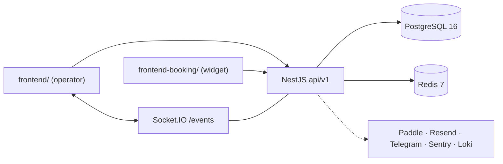

# WashFlow — System Overview

Multi-tenant CRM for car-wash businesses. NestJS + Prisma + PostgreSQL + Redis on the back end,
two React SPAs on the front end. Tenant isolation is enforced at the ORM layer, scheduling is
protected by row-level locking, and side effects run through domain events and BullMQ queues.

> **Detailed documentation lives in [`docs/context/`](docs/context/README.md).**
> This file is the high-level map. It deliberately does not repeat endpoint tables, schema
> details, or configuration reference — those are maintained in one place each, listed below.
> When something here and a `docs/context/*` page disagree, the context page is more specific;
> when either disagrees with the code, **the code wins**
> ([hierarchy](docs/context/README.md#4-source-of-truth-hierarchy)).

---

## Where to read next

| Topic                                                       | Document                                                         |
| ----------------------------------------------------------- | ---------------------------------------------------------------- |
| Orientation, task→doc matrix, conventions                   | [docs/context/README.md](docs/context/README.md)                 |
| Topology, request/async lifecycles, decisions and tradeoffs | [docs/context/architecture.md](docs/context/architecture.md)     |
| Every backend module, dependency graph, change-impact guide | [docs/context/modules.md](docs/context/modules.md)               |
| Prisma models, enums, relations, indexes, migrations        | [docs/context/data-model.md](docs/context/data-model.md)         |
| Both frontends: bootstrap, routing, API/auth/query/realtime | [docs/context/frontend.md](docs/context/frontend.md)             |
| Docker, env vars, CI/CD, observability, integrations        | [docs/context/infrastructure.md](docs/context/infrastructure.md) |
| Domain invariants and business rules                        | [docs/context/business-logic.md](docs/context/business-logic.md) |
| Product capabilities and every screen                       | [docs/context/features.md](docs/context/features.md)             |
| Full route inventory + seed data                            | [docs/context/reference.md](docs/context/reference.md)           |
| Task recipes, commands, doc-update matrix                   | [docs/context/agent-playbook.md](docs/context/agent-playbook.md) |
| Contributor workflow, scripts, PR checklist, runbook        | [docs/CONTRIBUTING.md](docs/CONTRIBUTING.md)                     |
| Install and run                                             | [README.md](README.md)                                           |

---

## What the system is made of

| Component          | Path                | Runtime                                                                                  |
| ------------------ | ------------------- | ---------------------------------------------------------------------------------------- |
| API + workers      | `src/`              | One NestJS process: HTTP (`api/v1`), Socket.IO (`/events`), cron jobs, BullMQ processors |
| Operator dashboard | `frontend/`         | React 19 SPA; served by nginx in production, which proxies `/api` and `/socket.io`       |
| Booking widget     | `frontend-booking/` | React 19 SPA, one build per tenant (`VITE_TENANT_ID` → `x-carwash-tenant-id`)            |
| Database           | PostgreSQL 16       | Prisma 7 via `@prisma/adapter-pg`, pool max 15                                           |
| Cache / queues     | Redis 7             | BullMQ, Paddle webhook idempotency, Paddle price cache                                   |

Rate limiting does **not** use Redis: `ThrottlerModule.forRoot` is registered without a
`storage` option, so counters live in the default in-memory store, per process.

External services are all optional, but they do not degrade the same way. **Resend** (email),
**Telegram Bot API** (support), **Sentry** (errors/traces) and **Grafana Cloud Loki** (logs)
no-op or fall back when unconfigured. **Paddle** (billing) is gated by `PAYMENTS_ENABLED` — its
mutations return 503 when payments are off. Payments default to off, including production
Compose; enabling them requires all three nonblank Paddle credentials at startup. Configured
credentials can still fail against Paddle at runtime; catalogue reads then use fallback prices.
See [configuration and operational limits](docs/context/infrastructure.md).

---

## The numbers

| Thing                                      | Count                                                |
| ------------------------------------------ | ---------------------------------------------------- |
| Backend feature modules                    | 24 registered in `AppModule` (+ `IdempotencyModule`) |
| Controllers / routes                       | 24 classes, 113 routes, 17 public                    |
| Prisma models / enums                      | 20 / 8                                               |
| Soft-deleted models                        | 9                                                    |
| Permissions / permission modules           | 47 / 14                                              |
| Domain event types                         | 18                                                   |
| BullMQ queues / cron jobs                  | 3 / 3                                                |
| Frontend feature folders / i18n namespaces | 21 / 18 per language (EN, UK)                        |

Recount them with the commands in
[agent-playbook.md](docs/context/agent-playbook.md#useful-search-commands) rather than editing
these by hand.

---

## The rules that define the system

1. **Tenant isolation at the ORM layer.** `TenantPrismaService.forTenant(tenantId)` injects
   `tenantId` and filters `deletedAt`. Exceptions — `Permission`, `RolePermission`,
   `IdempotencyKey`, `Tenant`, `Subscription`, `SubscriptionAddon`, `BookingSettings`,
   `PasswordResetToken`, and any `$transaction` client — are handled explicitly on raw
   `PrismaService`.
2. **Secure by default.** A global `JwtAuthGuard` protects everything; `@Public()` is an opt-out
   that must come with rate limiting. `PermissionsGuard` enforces `module.action` strings carried
   in the JWT. A global `TenantGuard` additionally allows audited super-admin tenant switching.
3. **No double booking.** Create and restore reserve work posts before employees inside a
   `Serializable` transaction, locking stable resource rows even when there are no bookings.
   Serialization conflicts retry at most three attempts; see
   [reservation rules](docs/context/business-logic.md#reservation-order-creation-and-restore).
4. **Repository pattern.** Controllers → services (rules, transactions, events) → repositories
   (Prisma only).
5. **Side effects are events.** Services dispatch `DomainEvent`s; audit, realtime and queue
   subscribers react independently and never fail the request.
6. **Soft delete with restore.** Nine models, `PATCH /:id/restore` on eight of them, and a daily
   retention cron that hard-deletes children before parents.
7. **Idempotent mutations.** Order creation and public bookings use service-level idempotency
   inside their transaction; payments use `IdempotencyInterceptor`. 24 h TTL, hourly cleanup.
8. **Limits come from the subscription.** Create and restore check quotas and mutate inside
   one tenant-locked transaction; no subscription row means no limits.
   [Payments](docs/context/business-logic.md#payments) likewise serialize on the order and use
   Decimal arithmetic. Public confirmations expose an explicit
   [privacy contract](docs/context/reference.md#public-booking); dashboard account changes clear
   [session caches](docs/context/frontend.md#auth-and-token-handling-sharedstoresauthstorets).
9. **Configuration fails loudly.** Zod validates the environment at startup; a `*` CORS origin in
   production exits the process.

---

## Working agreement

- `pnpm` only; three lockfiles (root, `frontend/`, `frontend-booking/`).
- Root `pnpm lint` runs `eslint --fix` — use `pnpm exec eslint …` when you only want to check.
- Backend `PORT` defaults to `3000`, but the Vite proxies and the CI Playwright job use `3003`.
- **After any business-logic or feature change, update this file _and_ the specific
  `docs/context/*` page** listed in the
  [documentation update matrix](docs/context/agent-playbook.md#documentation-update-matrix).
  Keep the detail in `docs/context/`; keep this file a map.
- Never commit secrets. `.env` and `.env.docker` are gitignored; the `*.example` files carry
  placeholders only.
