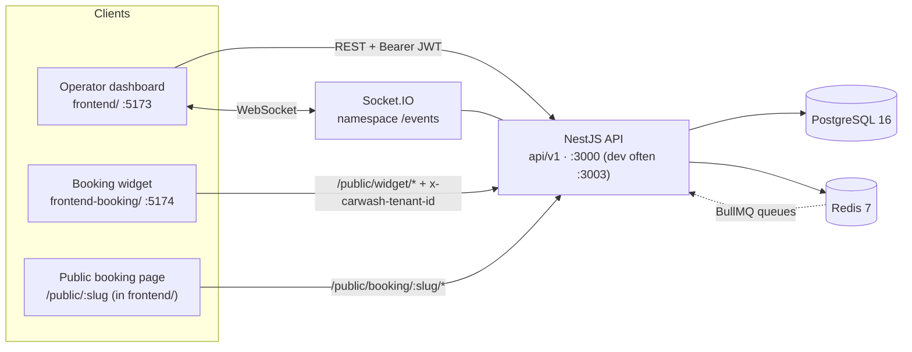

# WashFlow — Agent Context Entry Point

**This file is the canonical starting point for any human or AI agent working on WashFlow.**
Read this page first (≈5 min), then load only the documents your task needs.

WashFlow is a multi-tenant car-wash management SaaS: a NestJS + Prisma backend, a React
operator dashboard, and a standalone React booking widget, backed by PostgreSQL and Redis.

---

## 1. Five-minute orientation

| Question               | Answer                                                                                              |
| ---------------------- | --------------------------------------------------------------------------------------------------- |
| What runs?             | 1 backend (NestJS 11), 2 frontends (`frontend/`, `frontend-booking/`), PostgreSQL 16, Redis 7       |
| Where is backend code? | `src/` — `src/modules/<feature>/` per feature, `src/common/`, `src/config/`, `src/prisma/`          |
| API prefix             | `api/v1` (`app.setGlobalPrefix('api/v1')` in `src/main.ts`)                                         |
| Default backend port   | `PORT` env, default `3000`. Both Vite dev proxies target `http://localhost:3003` — see note below.  |
| Package manager        | `pnpm` (three separate lockfiles: root, `frontend/`, `frontend-booking/`)                           |
| Auth                   | Global `JwtAuthGuard` — every route protected unless marked `@Public()`                             |
| Tenancy                | `TenantPrismaService.forTenant(tenantId)` injects `tenantId` + filters `deletedAt` at the ORM layer |
| Domain models          | 20 Prisma models, 8 enums (`prisma/schema.prisma`)                                                  |
| HTTP surface           | 24 `@Controller` classes, 113 routes, 17 of them `@Public()`                                        |
| Permissions            | 47 `module.action` permissions across 14 modules                                                    |
| Background work        | 3 BullMQ queues (`notifications`, `analytics`, `booking-confirmations`) + 3 cron jobs               |

### The five invariants you must not break

1. **Tenant isolation is enforced in the ORM.** Repositories call
   `tenantPrisma.forTenant(tenantId)`; the Prisma client extension adds `tenantId` to every
   query. Never hand-roll a `tenantId` filter, and never reach for raw `PrismaService` in a
   tenant-scoped repository without a documented reason (see [architecture.md](./architecture.md#5-tenant-isolation-and-its-exceptions)).
2. **Secure by default.** New endpoints inherit `JwtAuthGuard` + `TenantGuard`. Opting out
   (`@Public()`) is a deliberate, reviewable decision that must come with rate limiting.
3. **Repository pattern.** Only `*.repository.ts` files (and a documented set of services)
   touch Prisma. Controllers → services → repositories → Prisma.
4. **Booking correctness.** Slot reservation happens inside a `Serializable` transaction with
   `SELECT … FOR UPDATE`. Do not move work-post/employee assignment outside that transaction.
5. **Soft delete + restore.** 9 models are soft-deleted and auto-filtered. Deletes are
   reversible; a daily cron hard-deletes after the retention window.

### Port note (read before you run anything)

`src/config/env.validation.ts` defaults `PORT` to `3000`; `docker-compose.yml` publishes
`3000:3000` and `docker-compose.prod.yml` only `expose`s `3000` behind nginx. But
`frontend/vite.config.ts` and `frontend-booking/vite.config.ts` proxy `/api` to
`http://localhost:3003`, and the CI `frontend-e2e` job starts the backend with `PORT: '3003'`.
For local dev against the Vite proxy, set `PORT=3003` in your `.env`.
Details: [infrastructure.md](./infrastructure.md#ports-and-the-3000-vs-3003-split).

---

## 2. Task → document matrix

Load only what you need. Every row lists the docs to read **before** editing.

| If you are changing…                         | Read                                                                                                                                         |
| -------------------------------------------- | -------------------------------------------------------------------------------------------------------------------------------------------- |
| An HTTP endpoint / controller / DTO          | [modules.md](./modules.md) · [reference.md](./reference.md) · [architecture.md](./architecture.md#3-request-lifecycle-synchronous-http)      |
| A Prisma model, migration, or index          | [data-model.md](./data-model.md) · [business-logic.md](./business-logic.md#soft-delete)                                                      |
| A business rule (pricing, status, limits)    | [business-logic.md](./business-logic.md) · [modules.md](./modules.md)                                                                        |
| Scheduling / availability / double-booking   | [business-logic.md](./business-logic.md#scheduling-engine) · [modules.md](./modules.md#core-domain)                                          |
| Auth, RBAC, permissions, tokens              | [business-logic.md](./business-logic.md#authentication-and-rbac) · [architecture.md](./architecture.md#3-request-lifecycle-synchronous-http) |
| Multi-tenancy or a tenancy exception         | [architecture.md](./architecture.md#5-tenant-isolation-and-its-exceptions) · [data-model.md](./data-model.md#tenant-scoping-map)             |
| A domain event, subscriber, or queue job     | [architecture.md](./architecture.md#4-async-lifecycle-events-subscribers-jobs) · [modules.md](./modules.md#events-and-jobs-wiring)           |
| Subscriptions, plans, add-ons, Paddle        | [business-logic.md](./business-logic.md#subscriptions-and-billing-paddle) · [modules.md](./modules.md#billing)                               |
| An operator-dashboard screen or hook         | [frontend.md](./frontend.md#operator-dashboard-frontend) · [features.md](./features.md)                                                      |
| The standalone booking widget                | [frontend.md](./frontend.md#booking-widget-frontend-booking)                                                                                 |
| Public booking (slug or widget API)          | [business-logic.md](./business-logic.md#public-booking) · [reference.md](./reference.md#public-booking)                                      |
| Docker, Compose, env vars, CI, observability | [infrastructure.md](./infrastructure.md)                                                                                                     |
| Anything, and you want the recipe first      | [agent-playbook.md](./agent-playbook.md)                                                                                                     |
| Contributor workflow, scripts, PR checklist  | [../CONTRIBUTING.md](../CONTRIBUTING.md)                                                                                                     |

---

## 3. The document set

| Doc                                      | Scope                                                                                     | Size guide                  |
| ---------------------------------------- | ----------------------------------------------------------------------------------------- | --------------------------- |
| [agent-playbook.md](./agent-playbook.md) | Task recipes, minimal file sets, commands, search snippets, doc-update matrix             | Read first for "how do I…"  |
| [architecture.md](./architecture.md)     | System/container topology, request + async lifecycles, boundaries, decisions, tradeoffs   | Read for cross-cutting work |
| [modules.md](./modules.md)               | Every `src/modules/*` module: responsibility, surface, deps, models, events, key files    | Read for backend work       |
| [data-model.md](./data-model.md)         | Every Prisma model + enum, relations, indexes, tenancy, soft delete, ER diagrams          | Read for schema work        |
| [frontend.md](./frontend.md)             | `frontend/` and `frontend-booking/`: bootstrap, routing, API/auth/query/realtime patterns | Read for UI work            |
| [infrastructure.md](./infrastructure.md) | Local setup, Compose variants, env vars, CI DAG, observability, integrations, unknowns    | Read for ops/config work    |
| [business-logic.md](./business-logic.md) | Domain invariants: tenancy, RBAC, scheduling, workforce, orders, billing, idempotency     | Read for rule changes       |
| [features.md](./features.md)             | Backend capabilities + every frontend screen/route                                        | Read for product scoping    |
| [reference.md](./reference.md)           | Verified endpoint inventory (path, method, auth, permission), seed data                   | Read for API lookups        |

---

## 4. Source-of-truth hierarchy

When two statements disagree, the higher tier wins. **Runtime code always beats prose.**

```
1. Runtime source        src/**, prisma/schema.prisma, prisma/migrations/**,
                         frontend/src/**, frontend-booking/src/**,
                         docker-compose*.yml, Dockerfile*, .github/workflows/ci.yml
2. Config + examples     src/config/env.validation.ts, .env.example, .env.docker.example
3. Tests                 src/**/*.spec.ts, test/**/*.e2e-spec.ts, frontend/e2e/**
4. docs/context/**       This set — derived from 1–3, kept in sync by hand
5. OVERVIEW.md           High-level product/system summary that points here
6. README.md             Repo front door + quick start
```

`docs/context/**` is **derived documentation**, not a specification. If you find a
contradiction, fix the doc, not the code — unless the code is genuinely wrong, in which case
say so explicitly rather than silently "correcting" the docs to match a bug.

### Freshness and maintenance rules

- **After a business-logic or feature change**, update the affected `docs/context/*` page **and**
  `OVERVIEW.md`. The doc-update matrix in
  [agent-playbook.md](./agent-playbook.md#documentation-update-matrix) says which file maps to which change.
- **Numbers are load-bearing.** Endpoint counts, model counts, and permission counts appear in
  this file and in `reference.md`. Recount them from source (commands in
  [agent-playbook.md](./agent-playbook.md#useful-search-commands)) rather than adjusting them by hand.
- **Never document a value you did not read from a file.** Prefer variable _names_ over values;
  never copy anything out of `.env` or `frontend/.env`.
- **Mark unknowns as unknown.** [infrastructure.md](./infrastructure.md#8-known-unknowns) has a
  dedicated section for things the repository does not evidence.

---

## 5. Repository map

```
WashFlow/
├── src/                     NestJS backend
│   ├── main.ts              bootstrap: helmet, cookies, CORS, pipes, filters, interceptor, Swagger
│   ├── instrument.ts        Sentry init (imported first by main.ts)
│   ├── app.module.ts        root module: config, logging, throttler, events, cron, BullMQ, global guards
│   ├── config/              Zod env schema (env.validation.ts) + typed config (configuration.ts)
│   ├── prisma/              PrismaService (@Global) + TenantPrismaService (tenant/soft-delete extension)
│   ├── common/              decorators · guards · filters · interceptors · middleware · events · utils · types
│   └── modules/             24 feature modules — see modules.md
├── prisma/
│   ├── schema.prisma        20 models, 8 enums
│   ├── migrations/          15 migrations + migration_lock.toml
│   └── seed.ts              demo tenant with ~1 year of generated operations
├── test/                    backend E2E (`*.e2e-spec.ts`, jest-e2e.json)
├── frontend/                operator dashboard (React 19 + Vite + Tailwind 4), nginx Dockerfile, Playwright E2E
├── frontend-booking/        standalone booking widget (React 19 + Vite), header-based tenancy
├── docs/
│   ├── CONTRIBUTING.md      contributor workflow, scripts, runbook
│   └── context/             ← you are here
├── docker-compose.yml       full local stack (postgres + redis + backend)
├── docker-compose.dev.yml   infrastructure only (postgres + redis)
├── docker-compose.prod.yml  production stack (postgres + redis + backend + nginx frontend)
├── Dockerfile               backend multi-stage build
├── .github/workflows/ci.yml lint → test → E2E → build/push → deploy
├── OVERVIEW.md              product/system summary
└── README.md                front door
```

### Runtime map



External services are all optional, but they do not degrade the same way. Resend (email),
Telegram Bot API (support), Sentry (errors/traces) and Grafana Cloud Loki (logs) no-op or fall
back when unconfigured. Paddle (billing) is gated by `PAYMENTS_ENABLED` and its mutations
return 503 when payments are off. `PAYMENTS_ENABLED` defaults to false, including production
Compose. Explicitly enabling it requires all three nonblank Paddle credentials at startup in
every environment; partial credential sets are rejected. Configured credentials can still fail
against Paddle at runtime, while catalogue reads fall back to hard-coded prices.
See [infrastructure.md](./infrastructure.md#6-external-integrations).

---

## 6. Conventions cheat sheet

| Concern        | Convention                                                                                    |
| -------------- | --------------------------------------------------------------------------------------------- |
| Module layout  | `*.module.ts` · `*.controller.ts` · `*.service.ts` · `*.repository.ts` · `dto/` · `*.spec.ts` |
| Tenant access  | `@CurrentTenant() tenantId: string` param decorator → `tenantPrisma.forTenant(tenantId)`      |
| Branch scoping | `@CurrentBranch() branchId: string \| null` + `applyBranchScope()` in `src/common/utils`      |
| Permissions    | `@UseGuards(PermissionsGuard)` on the controller + `@Permissions('module.action')` per route  |
| Public routes  | `@Public()` + an explicit `@Throttle({...})`                                                  |
| Validation     | `class-validator` DTOs (controllers) · Zod (env only)                                         |
| Pagination     | `PaginationDto` → `buildPaginationArgs()` / `paginatedResponse()`                             |
| Response shape | `TransformInterceptor` — see [architecture.md](./architecture.md#response-envelope)           |
| Errors         | `AllExceptionsFilter` + `PrismaExceptionFilter` (P2002→409, P2025→404, P2003→400)             |
| Frontend data  | TanStack Query hooks in `features/<x>/hooks/`, axios calls in `features/<x>/api/`             |
| Frontend state | Zustand stores in `frontend/src/shared/stores/`                                               |

---

Related: [../CONTRIBUTING.md](../CONTRIBUTING.md) · [../../OVERVIEW.md](../../OVERVIEW.md) · [../../README.md](../../README.md)
