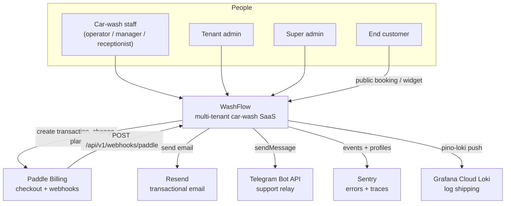
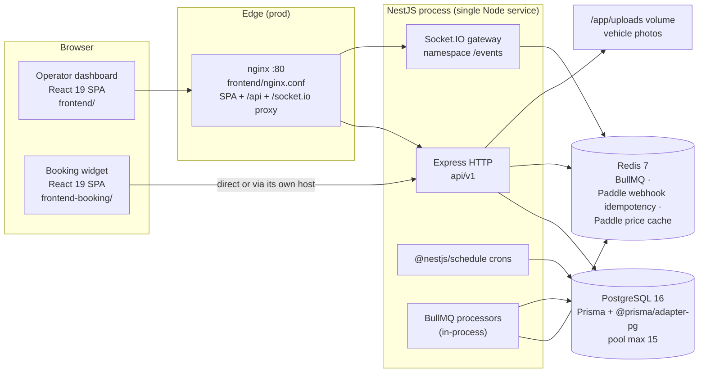
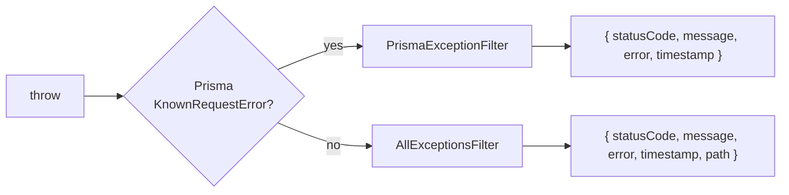
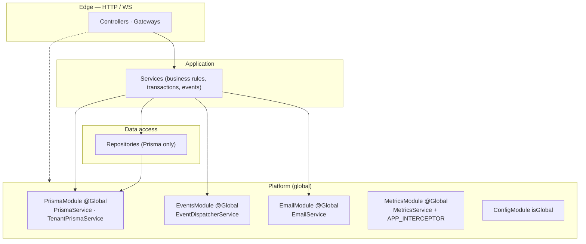

# Architecture

How WashFlow is put together: topology, the two request lifecycles (sync and async),
dependency boundaries, and the decisions behind them.

**Read this when** you are touching anything cross-cutting — guards, filters, interceptors,
events, transactions, tenancy — or when you need to know where a concern belongs.
**Entry point:** [README.md](./README.md) · **Modules:** [modules.md](./modules.md) ·
**Schema:** [data-model.md](./data-model.md)

---

## 1. System context



External integrations can be left unconfigured. Paddle mutations default to disabled;
explicitly enabling them requires all three nonblank credentials at startup. Partial Paddle
configuration also fails validation — see [§8 Degraded behaviour](#8-degraded-behaviour).

---

## 2. Container / runtime topology



Facts behind the diagram:

- The backend is **one process**. HTTP, WebSocket gateway, cron jobs and BullMQ workers all
  run in it (`src/app.module.ts` imports `ScheduleModule.forRoot()`, `BullModule.forRootAsync`,
  and `JobsModule` registers both producers and `@Processor` classes).
- `frontend/` is served as static files by nginx in production
  (`frontend/Dockerfile` → `nginx:alpine`, `frontend/nginx.conf`). nginx reverse-proxies
  `/api` and `/socket.io` to `backend:3000`.
- `frontend-booking/` has **no Dockerfile and no nginx config in this repo**; only
  `pnpm build` producing `dist/`. How it is hosted is not evidenced here — see
  [infrastructure.md](./infrastructure.md#8-known-unknowns).
- Vehicle photos are written to disk (`./uploads/vehicles`) and served by Express at
  `/uploads` (`app.useStaticAssets` in `src/main.ts`). In prod this is the `uploads_data`
  Docker volume.
- Socket.IO is single-node here. `@socket.io/redis-adapter` is a declared dependency in
  `package.json` but is **not wired up** in `src/modules/realtime/`; horizontal scaling of
  the gateway would require adding it.

---

## 3. Request lifecycle (synchronous HTTP)

### Bootstrap order — `src/main.ts`

1. `import './instrument'` — Sentry `init()` if `SENTRY_DSN` is set (must be first import).
2. `NestFactory.create<NestExpressApplication>(AppModule, { bufferLogs: true, rawBody: true })`
   — `rawBody` is required for Paddle webhook HMAC verification.
3. `app.useLogger(app.get(PinoLogger))` — nestjs-pino replaces the Nest logger.
4. `app.set('trust proxy', 1)` — so `req.ip` is the real client IP behind nginx/Cloudflare
   (per-IP throttling depends on this).
5. `app.setGlobalPrefix('api/v1')`.
6. `helmet(...)` with an explicit CSP allowing `cdn.paddle.com`, `*.paddle.com`, `*.sentry.io`,
   `ws:`/`wss:`.
7. `cookieParser()` — the refresh token lives in an httpOnly cookie.
8. `app.useStaticAssets(<root>/uploads, { prefix: '/uploads' })`.
9. CORS: `CORS_ORIGINS`, comma-separated; `credentials: true`; allowed headers
   `Content-Type`, `Authorization`, `x-carwash-tenant-id`, `idempotency-key`.
   **`CORS_ORIGINS='*'` in `NODE_ENV=production` logs an error and exits the process.**
10. Global `ValidationPipe` — `whitelist`, `forbidNonWhitelisted`, `transform`,
    `enableImplicitConversion`.
11. Global filters: `AllExceptionsFilter(config)` then `PrismaExceptionFilter()`.
12. Global interceptor: `TransformInterceptor`.
13. `enableShutdownHooks()`.
14. Swagger at `/api/docs` — **only when `NODE_ENV !== 'production'`**.
15. `server.setTimeout(30_000)` then `app.listen(PORT)`.

`AppModule.configure()` additionally applies `CorrelationIdMiddleware` to `*`.

### Per-request path

```mermaid
sequenceDiagram
  autonumber
  participant C as Client
  participant EX as Express (helmet, cookies, CORS, static)
  participant MW as CorrelationIdMiddleware
  participant G1 as JwtAuthGuard (APP_GUARD)
  participant G2 as CustomThrottlerGuard (APP_GUARD)
  participant G3 as TenantGuard (APP_GUARD)
  participant G4 as PermissionsGuard (per controller)
  participant P as ValidationPipe
  participant I as Interceptors (Metrics, Transform, Idempotency*)
  participant CT as Controller
  participant SV as Service
  participant RP as Repository
  participant DB as Prisma / PostgreSQL

  C->>EX: HTTP request
  EX->>MW: x-correlation-id (in or generated) → req + response header
  MW->>G1: @Public()? skip : passport-jwt validate
  G1->>G2: tracker = user-<sub> or client IP
  G2->>G3: @Public()? skip
  Note over G3: super admin may override tenant<br/>via x-tenant-id (UUID, must exist)<br/>→ dispatches SuperAdminTenantAccessEvent
  G3->>G4: @Permissions(...) present?
  Note over G4: isSuperAdmin bypasses;<br/>otherwise every listed permission<br/>must be in the JWT permissions[]
  G4->>P: DTO validation / transform
  P->>I: MetricsInterceptor (APP_INTERCEPTOR, global)
  I->>CT: handler
  CT->>SV: @CurrentTenant() / @CurrentBranch() / @CurrentUser()
  SV->>RP: business rules, transactions
  RP->>DB: tenantPrisma.forTenant(tenantId).<model>....
  DB-->>RP: rows
  RP-->>SV: entities
  SV-->>CT: result
  CT-->>I: TransformInterceptor wraps into envelope
  I-->>C: 2xx JSON
```

`*` `IdempotencyInterceptor` is applied per handler (`@UseInterceptors(IdempotencyInterceptor)`),
currently only on `POST /orders/:orderId/payments`.

### Guards, in order

| Guard                  | Registration                        | Behaviour                                                                                                                    |
| ---------------------- | ----------------------------------- | ---------------------------------------------------------------------------------------------------------------------------- |
| `JwtAuthGuard`         | `APP_GUARD` in `app.module.ts`      | `passport-jwt`; skipped when `@Public()`                                                                                     |
| `CustomThrottlerGuard` | `APP_GUARD` (`useExisting`)         | Tracks by `user-<sub>` when authenticated, else client IP. `ThrottlerModule.forRoot([])` in `NODE_ENV=test` makes it a no-op |
| `TenantGuard`          | `APP_GUARD`                         | Requires `user.tenantId`; super admins may switch tenant with a valid `x-tenant-id` UUID that resolves to an existing tenant |
| `PermissionsGuard`     | `@UseGuards()` per controller       | All `@Permissions(...)` must be present; `isSuperAdmin` bypasses                                                             |
| `SuperAdminGuard`      | `@UseGuards()` per route/controller | `GET /tenants`, `POST /tenants`, `/tenants/:tenantId/subscription`                                                           |
| `PaymentsEnabledGuard` | `@UseGuards()` per route            | 503 unless `PAYMENTS_ENABLED=true` — guards Paddle mutations                                                                 |
| `MetricsAuthGuard`     | `@UseGuards()` on `/metrics`        | Bearer `METRICS_TOKEN`; **denies in production when the token is unset**, allows in dev/test                                 |

`ThrottlerModule.forRoot` registers two named throttlers: `short` (10 req / 1 s) and `long`
(100 req / 60 s). Route overrides use `@Throttle({ short: { … } })`.

`forRoot` is called with the throttler array only — **no `storage` option**, so counters live
in `@nestjs/throttler`'s default in-memory store, not in Redis. Limits are therefore
**per process**: they survive a Redis outage, but they would also be enforced independently by
each replica if the backend were ever scaled out.

> **Observation, not a claim about behaviour:** the two public-booking controllers use
> `@Throttle({ default: { limit: 20 | 5, ttl: 60000 } })`, but no throttler named `default` is
> registered. Everywhere else (`auth`, `payments`, `support`) the override targets `short`.
> If you touch public-booking rate limits, verify the effective limit rather than trusting the
> decorator name.

### Response envelope

`TransformInterceptor` (`src/common/interceptors/transform.interceptor.ts`) wraps every
successful response. There are exactly two shapes:

```jsonc
// Any value that is NOT { items, total }
{ "data": <value>, "meta": { "timestamp": "2026-01-01T00:00:00.000Z" } }

// A service returning { items, total, page, limit, totalPages } (paginatedResponse())
{
  "data": [ /* items — the array is hoisted to the top level */ ],
  "meta": { "timestamp": "…", "total": 100, "page": 1, "limit": 20, "totalPages": 5 }
}
```

Pagination metadata is **flat inside `meta`**, and `data` is the array itself — not a nested
`{ items, meta }` object. The frontend relies on this: `toPaginated()` in
`frontend/src/shared/api/client.ts` maps `resp.data` → `items` and `resp.meta` → `meta`.

### Error path



- `PrismaExceptionFilter`: `P2002 → 409`, `P2025 → 404`, `P2003 → 400`, anything else → 500
  `'Database error'`. It does not include `path`. Booking create/restore handles `P2034` and
  narrowly classified `P2010` PostgreSQL adapter serialization/deadlock causes earlier: retry
  the whole `Serializable` reservation up to three attempts, then return `409`.
- `AllExceptionsFilter`: `HttpException` keeps its status/message (array messages joined with
  `, `). A non-`HttpException` `Error` leaks its message **only in `NODE_ENV=development`**;
  otherwise it becomes `'Internal server error'`. Status ≥ 500 is logged with the stack.
- Sentry captures unhandled errors through `SentryModule.forRoot()` (registered first in
  `AppModule`) plus the `instrument.ts` init.

---

## 4. Async lifecycle (events, subscribers, jobs)

Business services never call the audit log, the WebSocket gateway, or a queue directly. They
dispatch a `DomainEvent` through `EventDispatcherService` (a thin wrapper over
`EventEmitter2`), and independent subscribers react.

```mermaid
flowchart TB
  subgraph producers["Producers"]
    ORD["OrdersService"]
    CLI["ClientsService"]
    AUTH["AuthService"]
    TG2["TenantGuard"]
    PAY["PaymentsService"]
    SUB["PaddleWebhookService"]
  end

  ED["EventDispatcherService<br/>EventEmitter2.emit(event.eventType, event)"]

  producers --> ED

  ED --> AS["AuditSubscriber<br/>modules/audit"]
  ED --> RS["RealtimeSubscriber<br/>modules/realtime"]
  ED --> JS["JobsSubscriber<br/>modules/jobs"]

  AS --> AL[("audit_logs")]
  RS --> GWY["RealtimeGateway<br/>emitToTenant / emitToBranch"]
  GWY --> SOCK["Connected clients in<br/>tenant:{id} / branch:{id}"]

  JS --> NQ["notifications queue"]
  JS --> AQ["analytics queue"]
  JS --> BQ["booking-confirmations queue"]

  NQ --> NP["NotificationProcessor<br/>→ EmailService → Resend"]
  AQ --> AP["AnalyticsProcessor"]
  BQ --> BP["BookingConfirmationProcessor"]
```



### Event catalogue

`EventType` (`src/common/events/event-types.ts`) — 18 values:

| Event key                       | Emitted by                                                      | Consumed by                                                                             |
| ------------------------------- | --------------------------------------------------------------- | --------------------------------------------------------------------------------------- |
| `order.created`                 | `OrdersService.create`                                          | `AuditSubscriber`, `RealtimeSubscriber`, `JobsSubscriber`                               |
| `order.status_changed`          | `OrdersService.updateStatus`                                    | `AuditSubscriber`, `RealtimeSubscriber`, `JobsSubscriber`                               |
| `order.cancelled`               | `OrdersService.updateStatus` when the new status is `CANCELLED` | `AuditSubscriber`, `RealtimeSubscriber`                                                 |
| `order.updated`                 | declared in `EventType`, **no dispatch site in `src/`**         | —                                                                                       |
| `client.deleted`                | `ClientsService.softDelete`                                     | `AuditSubscriber`                                                                       |
| `client.merged`                 | `ClientsService.merge`                                          | `AuditSubscriber`                                                                       |
| `payment.received`              | `PaymentsService.create`                                        | no `@OnEvent` handler in `src/`; the dashboard has a `payment.received` socket listener |
| `booking.confirmed`             | declared in `EventType`, **no dispatch site in `src/`**         | the dashboard has a `booking.confirmed` socket listener                                 |
| `auth.login`                    | `AuthService.login`                                             | `AuditSubscriber`                                                                       |
| `auth.login_failed`             | `AuthService.login` (unknown email and wrong password)          | `AuditSubscriber` (tenantId is the literal `'system'`)                                  |
| `auth.password_changed`         | `AuthService.changePassword` and `AuthService.resetPassword`    | `AuditSubscriber`                                                                       |
| `auth.logout`                   | `AuthService.logout`                                            | `AuditSubscriber`                                                                       |
| `auth.superadmin_tenant_access` | `TenantGuard`                                                   | `AuditSubscriber`                                                                       |
| `auth.account_locked`           | `AuthService.login` (lockout threshold)                         | no `@OnEvent` handler in `src/`                                                         |
| `auth.password_reset_requested` | `AuthService.forgotPassword`                                    | no `@OnEvent` handler in `src/` (tenantId `'system'`)                                   |
| `subscription.activated`        | `PaddleWebhookService`                                          | no `@OnEvent` handler in `src/`                                                         |
| `subscription.changed`          | `PaddleWebhookService`                                          | no `@OnEvent` handler in `src/`                                                         |
| `subscription.cancelled`        | `PaddleWebhookService`                                          | no `@OnEvent` handler in `src/`                                                         |

Events with no subscriber are still emitted; they are extension points, not dead code, but do
not assume a side effect exists without grepping for `@OnEvent`.

### Queues

| Queue                   | Producer                      | Jobs                                                       | Retry policy                                                                    |
| ----------------------- | ----------------------------- | ---------------------------------------------------------- | ------------------------------------------------------------------------------- |
| `notifications`         | `NotificationProducer`        | `order-confirmation`, `status-update`, `booking-reminder`  | `attempts: 3`, exponential backoff 1 s (reminder: `attempts: 2` with a `delay`) |
| `analytics`             | `AnalyticsProducer`           | `order-created`, `order-completed`                         | producer default                                                                |
| `booking-confirmations` | `BookingConfirmationProducer` | confirmation timeout (30 min, only for `source === 'WEB'`) | `attempts: 3`, exponential backoff 5 s                                          |

`HealthModule` registers the same three queues so `BullMQHealthIndicator` can report on them.

### Cron jobs

Three `@Cron` handlers, all running in the single backend process (no leader election — see
[§7](#7-key-decisions-and-tradeoffs)):

| Schedule           | Service / method                       | Effect                                                                                                            |
| ------------------ | -------------------------------------- | ----------------------------------------------------------------------------------------------------------------- |
| `EVERY_DAY_AT_2AM` | `CleanupService`                       | Hard-deletes rows soft-deleted before `now − CLEANUP_RETENTION_DAYS`, in FK-safe order, inside one `$transaction` |
| `EVERY_HOUR`       | `IdempotencyCleanupService`            | Deletes expired `idempotency_keys`                                                                                |
| `EVERY_HOUR`       | `PaddlePriceCacheService.refreshCache` | Refetches Paddle prices and rewrites `paddle:prices:catalog` in Redis with a 1 h TTL                              |

`refreshCache` returns early — logging a warning and leaving Redis untouched — in two cases:
when `collectAllPriceIds()` resolves to an empty list ("No Paddle price IDs configured"), and
when the Paddle circuit breaker is open. Price ids come from `PADDLE_PRICE_IDS` /
`PADDLE_ADDON_PRICE_IDS` merged over the placeholder defaults in
`src/modules/subscriptions/plan.constants.ts`, so the empty case is only reachable when every
id is overridden with a blank value.

`onModuleInit` calls the same method once at startup. That call is wrapped in `try/catch` and
only logs a warning, so a Paddle failure at boot leaves the catalogue on its hard-coded
fallback rather than failing startup. The hourly invocation has no such wrapper.

### Realtime

`RealtimeGateway` (`namespace: '/events'`):

- Auth on handshake: token from `handshake.auth.token` or the `Authorization` header; verified
  with `jwt.accessSecret`; **rejects non-`access` tokens**; disconnects when missing/invalid.
- Auto-joins `tenant:{tenantId}`. `emitToBranch` targets `branch:{branchId}`.
- A 60 s interval sweeps connected sockets and disconnects clients whose token expired.
- CORS is set in `afterInit()` from `CORS_ORIGINS`; `'*'` or empty means "allow all" in dev and
  **`false` (deny) in production**.

---

## 5. Tenant isolation and its exceptions

`TenantPrismaService.forTenant(tenantId)` returns a `$extends`-wrapped client
(`src/prisma/tenant-prisma.service.ts`) that, for **all** models:

- injects `tenantId` into `where` for `findMany`, `findFirst`, `update`, `updateMany`,
  `delete`, `deleteMany`, `count`, `aggregate`, `groupBy`, `upsert`, `findFirstOrThrow`;
- injects `tenantId` into `data` for `create`, `createMany`, and `upsert.create`;
- rewrites `findUnique` / `findUniqueOrThrow` so the tenant and soft-delete predicates are
  pushed into SQL rather than filtered in memory;
- adds `deletedAt: null` for the 9 soft-delete models, unless the caller passes
  `where._includeDeleted: true`.

**Exceptions — models that bypass `tenantId` injection entirely** (`BYPASS_TENANT_MODELS`):
`Permission`, `RolePermission`, `IdempotencyKey`.

**Soft-delete models** (`SOFT_DELETE_MODELS`): `User`, `Client`, `Order`, `Vehicle`, `Service`,
`Branch`, `Role`, `WorkPost`, `EmployeeProfile`.

Two more gaps the extension does not cover, and which therefore force raw `PrismaService`:

- **`Tenant` itself has no `tenantId` column** (its PK _is_ the tenant id), so
  `TenantsRepository` uses raw `PrismaService`.
- **`Subscription`, `SubscriptionAddon`, `PasswordResetToken`, `BookingSettings`** are handled
  by services/repositories on raw `PrismaService` with explicit filters. `SubscriptionAddon`
  and `PasswordResetToken` have no `tenantId` column at all — see
  [data-model.md](./data-model.md#tenant-scoping-map).

Files that inject raw `PrismaService` (verify before adding another):

```
src/common/guards/tenant.guard.ts          src/modules/orders/orders.service.ts
src/common/utils/booking-settings.util.ts  src/modules/permissions/permissions.repository.ts
src/modules/analytics/analytics-export.service.ts
src/modules/auth/auth.service.ts           src/modules/public-booking/public-booking.service.ts
src/modules/branches/branches.repository.ts src/modules/roles/roles.repository.ts
src/modules/cleanup/cleanup.service.ts     src/modules/roles/roles.service.ts
src/modules/health/health.controller.ts    src/modules/scheduling/scheduling.repository.ts
src/modules/idempotency/idempotency.repository.ts src/modules/scheduling/scheduling.service.ts
src/modules/jobs/processors/booking-confirmation.processor.ts
src/modules/jobs/processors/notification.processor.ts
src/modules/subscriptions/subscriptions.repository.ts
src/modules/tenants/tenants.repository.ts  src/modules/users/users.service.ts
src/modules/tenants/tenants.service.ts     src/modules/workforce/employee-profile.service.ts
```

`TenantsService` is on this list for `create()`: it opens a raw `$transaction` to insert the
`Tenant` row and its trial `Subscription` together, and scopes the `Subscription` by passing
`tenantId` explicitly — neither model is reachable through the extended client here.

Each tenant-scoped operation carries an explicit `tenantId` in its `where` clauses
(transaction clients inside `$transaction` are plain Prisma clients and cannot use the
extension). When you add code to one of them, the tenant filter is **your** responsibility.
Resource mutations passed into the quota transaction also write `tenantId` explicitly.

Concurrency boundaries are deliberately different: booking create/restore uses `Serializable`
with stable work-post locks before employee locks and bounded retry; payment creation uses
`ReadCommitted` with an order lock; resource create/restore uses `ReadCommitted` with a tenant
lock covering quota check and mutation. See the
[business rules](./business-logic.md) for each invariant. Raw settings resolution uses a
compound tenant/branch key for overrides; order reservation separately validates the active
parent and resources. Branch-scoped order and work-post operations apply the user's branch
as an additional boundary.

---

## 6. Dependency boundaries



Rules that hold in the current tree:

- Controllers do not import repositories. They depend on services (plus
  `SchedulingService` in `OrdersController` for the availability endpoint).
- Repositories contain Prisma queries and nothing else — no `throw new NotFoundException`,
  no event dispatch.
- Services own transactions (`$transaction`), business validation, and event dispatch.
- `PrismaModule`, `EventsModule`, `EmailModule`, `MetricsModule` are `@Global()` — do not add
  them to a feature module's `imports`.
- Cross-feature reuse goes through a module's `exports`. `SubscriptionsModule` exports
  `SubscriptionLimitsService` and `SubscriptionsRepository`; `UsersModule`, `BranchesModule`,
  `WorkPostsModule`, `ServicesModule` import it to enforce plan limits.
- Subscribers (`AuditSubscriber`, `RealtimeSubscriber`, `JobsSubscriber`) are the only
  `@OnEvent` consumers, and they live inside their owning module.

Full import graph and per-module detail: [modules.md](./modules.md).

---

## 7. Key decisions and tradeoffs

| Decision                                                                    | Why                                                                | Cost you inherit                                                                                                                                                      |
| --------------------------------------------------------------------------- | ------------------------------------------------------------------ | --------------------------------------------------------------------------------------------------------------------------------------------------------------------- |
| Tenant isolation via Prisma Client Extension                                | Impossible to "forget" a `tenantId` filter on extended clients     | Transaction clients and non-tenant models bypass it; those call sites are manual                                                                                      |
| Repository pattern                                                          | Business logic is testable without a DB                            | More files; some services still hold raw Prisma for transactional work                                                                                                |
| Stateless JWT + `tokenVersion` column                                       | No session store; horizontal scaling                               | Revocation is per-user (bump `tokenVersion`), not per-token                                                                                                           |
| Refresh token in an httpOnly cookie scoped to `/api/v1/auth`                | Not readable by JS; no CSRF surface for a Bearer JSON API          | Refresh only works from the same origin/path; SPA must call `POST /auth/refresh`                                                                                      |
| `SELECT … FOR UPDATE` inside a `Serializable` transaction                   | Database-level guarantee against double booking                    | Serialization failures surface as conflicts; keep the transaction small                                                                                               |
| Employee auto-assignment inside the same transaction                        | Removes the TOCTOU window between "slot free" and "worker free"    | Order creation holds locks slightly longer                                                                                                                            |
| Domain events via `EventEmitter2`                                           | Audit / realtime / queueing decoupled from the request path        | In-process only — events are lost on crash; not a durable outbox                                                                                                      |
| BullMQ on Redis for side effects                                            | Retries, backoff, delayed jobs                                     | Redis becomes a hard runtime dependency                                                                                                                               |
| Hybrid idempotency (service-level + interceptor)                            | Transactional endpoints need the key inside their own transaction  | Two mechanisms to understand; see [business-logic.md](./business-logic.md#idempotency)                                                                                |
| Global `JwtAuthGuard` + `@Public()`                                         | New endpoints are protected by default                             | Public routes need explicit throttling, added by hand                                                                                                                 |
| Soft delete + restore on 9 models                                           | Operator mistakes are recoverable                                  | Every query path must respect `deletedAt`; uniqueness interacts with it (see below)                                                                                   |
| Zod-validated env at startup                                                | Misconfiguration fails immediately with a readable error           | Adding a variable means touching `env.validation.ts` **and** `configuration.ts`                                                                                       |
| Single process for HTTP + WS + cron + workers                               | Simple to run and deploy                                           | Cron and workers scale with the API; multi-replica needs a Socket.IO Redis adapter, cron leader election, and a shared throttler store (counters are in-memory today) |
| Feature-based folders (both backend and frontend)                           | A feature is self-contained and greppable                          | Shared code must be deliberately promoted to `common/` / `shared/`                                                                                                    |
| Post-build per-route meta prerender (`frontend/scripts/prerender-meta.mjs`) | Social scrapers and non-JS crawlers get correct per-route `<head>` | A second place that must know about public routes                                                                                                                     |

### Uniqueness and soft delete — an active constraint

Unique indexes that exist in `prisma/migrations/**` are **plain, not partial**:
`tenants.slug`, `users.email`, `booking_settings(tenantId, branchId)`,
`permissions(module, action)`, `role_permissions(roleId, permissionId)`,
`idempotency_keys(tenantId, key)`, `subscriptions.tenantId`,
`subscription_addons(subscriptionId, resource)`, `employee_profiles.userId`,
`password_reset_tokens.token`.

There is **no** `WHERE deleted_at IS NULL` partial unique index anywhere in the migrations.
Consequence: a soft-deleted `User` still occupies its email, and a soft-deleted
`EmployeeProfile` still occupies its `userId`. Client phone, vehicle plate and role name are
only _indexed_, not unique, so they are unaffected. Do not assume you can re-create a record
with the same email while the old row is soft-deleted.

A related sharp edge: `booking_settings(tenantId, branchId)` has a **nullable** `branchId`, and
PostgreSQL treats `NULL`s as distinct inside a unique index. Branch-level rows are genuinely
unique per tenant; the tenant-level row (`branchId = NULL`) is not constrained at all — see
[data-model.md](./data-model.md#bookingsettings--booking_settings).

---

## 8. Degraded behaviour

| Missing configuration                                   | Effect                                                                                                                                                                                                                                                                    |
| ------------------------------------------------------- | ------------------------------------------------------------------------------------------------------------------------------------------------------------------------------------------------------------------------------------------------------------------------- |
| `RESEND_API_KEY` empty                                  | `EmailService` logs at debug and returns; no email is sent. Never throws.                                                                                                                                                                                                 |
| Resend failing repeatedly                               | `CircuitBreaker` (`src/common/utils/circuit-breaker.ts`, threshold 5, reset 30 s) opens; sends are skipped with a warning                                                                                                                                                 |
| `TELEGRAM_BOT_TOKEN` / `TELEGRAM_SUPPORT_CHAT_ID` empty | `SupportService` warns "request dropped"; `POST /support` still returns success                                                                                                                                                                                           |
| Paddle keys unset                                       | `PAYMENTS_ENABLED` defaults to false and mutations return 503. Enabling it requires all three nonblank Paddle credentials at startup in every environment; partial credential sets are rejected even when disabled. Configured credentials may still fail at runtime, with catalogue fallback prices |
| `SENTRY_DSN` unset                                      | `instrument.ts` skips `Sentry.init` entirely                                                                                                                                                                                                                              |
| Grafana Loki vars unset (any of host/user/password)     | pino uses the default transport; no log shipping                                                                                                                                                                                                                          |
| `METRICS_TOKEN` unset in production                     | `/api/v1/metrics` returns 403 (guard denies)                                                                                                                                                                                                                              |
| Redis down                                              | Health check reports `redis` and `queues` down; BullMQ and Paddle webhook idempotency fail; the Paddle price cache logs and returns hard-coded prices. Throttling is **unaffected** — its counters are in-memory, so limits keep applying per process                     |

Production Redis uses `maxmemory-policy noeviction`: queue and idempotency keys are not
evicted to make room for cache writes. At the configured 1 GB memory ceiling, writes can fail
with OOM; monitor memory/queue health and size Redis for the combined workload. See
[infrastructure.md](./infrastructure.md#2-compose-variants).

---

Related: [modules.md](./modules.md) · [data-model.md](./data-model.md) ·
[business-logic.md](./business-logic.md) · [infrastructure.md](./infrastructure.md) ·
[frontend.md](./frontend.md)
