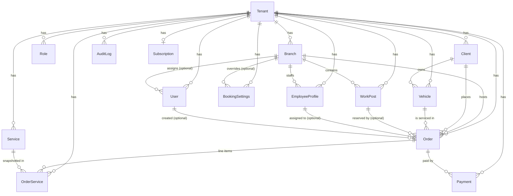
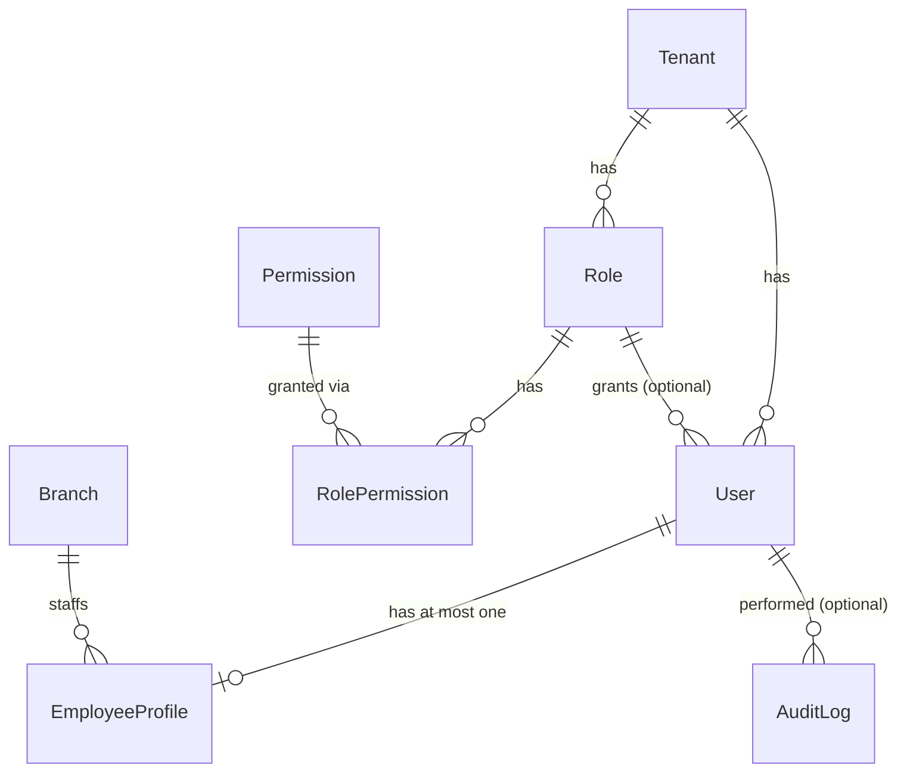
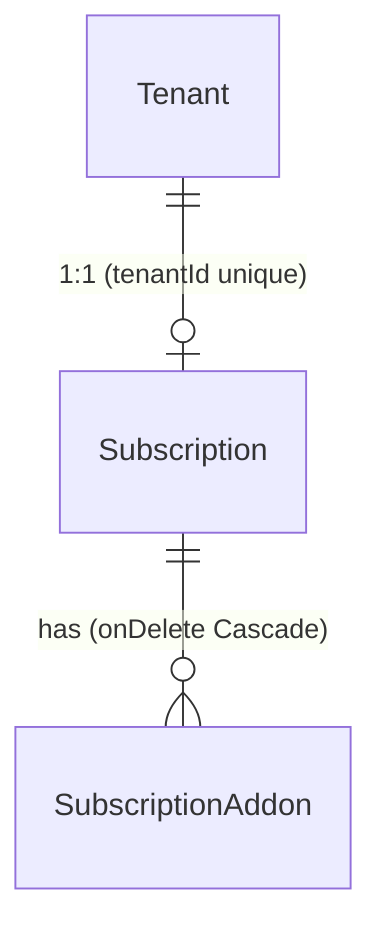

# Data Model

Complete reference for `prisma/schema.prisma`: **20 models, 8 enums**. Everything here is read
off the schema and `prisma/migrations/**`; service-level conventions are labelled as such.

**Read this when** you are adding a field, writing a migration, or reasoning about a relation.
**Entry point:** [README.md](./README.md) · **Tenancy mechanics:** [architecture.md](./architecture.md#5-tenant-isolation-and-its-exceptions)

Datasource: `postgresql`. Generator output: `../node_modules/.prisma/client`.
`datasource db` declares no `url` in the schema — the connection string is supplied at runtime
by `PrismaService` through `@prisma/adapter-pg` (and by `prisma.config.ts` for the CLI).

---

## 1. Enums

| Enum                 | Values                                                                                      | Used by                                    |
| -------------------- | ------------------------------------------------------------------------------------------- | ------------------------------------------ |
| `OrderStatus`        | `BOOKED`, `BOOKED_PENDING_CONFIRMATION`, `IN_PROGRESS`, `COMPLETED`, `CANCELLED`, `NO_SHOW` | `Order.status` (default `BOOKED`)          |
| `OrderSource`        | `INTERNAL`, `WEB`, `WIDGET`, `API`                                                          | `Order.source` (default `INTERNAL`)        |
| `PaymentStatus`      | `PENDING`, `PAID`, `PARTIALLY_PAID`, `REFUNDED`, `FAILED`                                   | `Payment.status` (default `PENDING`)       |
| `PaymentMethod`      | `CASH`, `CARD`, `ONLINE`, `OTHER`                                                           | `Payment.method` (required)                |
| `AuditAction`        | `CREATE`, `UPDATE`, `DELETE`, `STATUS_CHANGE`, `MERGE`                                      | `AuditLog.action`                          |
| `PlanTier`           | `TRIAL`, `STARTER`, `BUSINESS`, `ENTERPRISE`                                                | `Subscription.planTier` (default `TRIAL`)  |
| `BillingInterval`    | `MONTHLY`, `YEARLY`                                                                         | `Subscription.billingInterval` (nullable)  |
| `SubscriptionStatus` | `TRIALING`, `ACTIVE`, `PAST_DUE`, `PAUSED`, `CANCELLED`                                     | `Subscription.status` (default `TRIALING`) |

The order state machine that constrains `OrderStatus` transitions lives in code, not in the
database: `src/modules/orders/types/order.types.ts` — see
[business-logic.md](./business-logic.md#order-lifecycle).

---

## 2. Model inventory at a glance

| Model                | Table                   | `tenantId` column            | Soft delete | `createdAt`/`updatedAt`   | Owner module       |
| -------------------- | ----------------------- | ---------------------------- | ----------- | ------------------------- | ------------------ |
| `Tenant`             | `tenants`               | — (its `id` _is_ the tenant) | no          | both                      | tenants            |
| `BookingSettings`    | `booking_settings`      | yes                          | no          | neither                   | branches / tenants |
| `Branch`             | `branches`              | yes                          | **yes**     | both                      | branches           |
| `User`               | `users`                 | yes                          | **yes**     | both                      | users / auth       |
| `Role`               | `roles`                 | yes                          | **yes**     | both                      | roles              |
| `Permission`         | `permissions`           | **no** (global)              | no          | `createdAt` only          | permissions        |
| `RolePermission`     | `role_permissions`      | **no** (join)                | no          | neither                   | roles              |
| `Client`             | `clients`               | yes                          | **yes**     | both                      | clients            |
| `Vehicle`            | `vehicles`              | yes                          | **yes**     | both                      | vehicles           |
| `Service`            | `services`              | yes                          | **yes**     | both                      | services           |
| `WorkPost`           | `work_posts`            | yes                          | **yes**     | both                      | work-posts         |
| `Order`              | `orders`                | yes                          | **yes**     | both                      | orders             |
| `OrderService`       | `order_services`        | yes                          | no          | neither                   | orders             |
| `Payment`            | `payments`              | yes                          | no          | both                      | payments           |
| `AuditLog`           | `audit_logs`            | yes                          | no          | `createdAt` only          | audit              |
| `IdempotencyKey`     | `idempotency_keys`      | yes (**not injected**)       | no          | `createdAt` + `expiresAt` | idempotency        |
| `EmployeeProfile`    | `employee_profiles`     | yes                          | **yes**     | both                      | workforce          |
| `Subscription`       | `subscriptions`         | yes (unique)                 | no          | both                      | subscriptions      |
| `SubscriptionAddon`  | `subscription_addons`   | **no**                       | no          | both                      | subscriptions      |
| `PasswordResetToken` | `password_reset_tokens` | **no**                       | no          | `createdAt` + `expiresAt` | auth               |

All ids are `String @id @default(uuid())`. All date-times are `@db.Timestamptz`. All money is
`Decimal @db.Decimal(10, 2)` (`Service.price`, `Order.totalPrice`, `OrderService.price`,
`Payment.amount`) — **read these as `Decimal`, not `number`**; existing code coerces with
`Number(...)` where it aggregates.

### Tenant scoping map

`TenantPrismaService.forTenant()` injects `tenantId` into every model **except** the three in
`BYPASS_TENANT_MODELS`. Five models have no `tenantId` column at all: `Tenant`, `Permission`,
`RolePermission`, `SubscriptionAddon`, `PasswordResetToken`. Two of them — `Permission` and
`RolePermission` — are in `BYPASS_TENANT_MODELS`, so nothing is injected and they stay usable
through `forTenant()`. The other three — `Tenant`, `SubscriptionAddon`, `PasswordResetToken` —
are outside the bypass set, so `forTenant()` would inject a `tenantId` their tables do not
have; reach those through raw `PrismaService`:

| Category                                                 | Models                                                                                                                                  | How isolation is achieved                                                                                                                                                                                                                                                                                                                    |
| -------------------------------------------------------- | --------------------------------------------------------------------------------------------------------------------------------------- | -------------------------------------------------------------------------------------------------------------------------------------------------------------------------------------------------------------------------------------------------------------------------------------------------------------------------------------------- |
| Auto-injected (`tenantId` in `where` and `data`)         | `Branch`, `User`, `Role`, `Client`, `Vehicle`, `Service`, `WorkPost`, `Order`, `OrderService`, `Payment`, `AuditLog`, `EmployeeProfile` | ORM extension                                                                                                                                                                                                                                                                                                                                |
| Extension-covered in principle, accessed raw in practice | `Subscription`, `BookingSettings`                                                                                                       | Both have a `tenantId` and are absent from `BYPASS_TENANT_MODELS`, so `forTenant()` **would** scope them — but no call site uses it. `SubscriptionsRepository`, `TenantsService` / `AuthService` (`$transaction`), `TenantsRepository`, `BranchesRepository` and `resolveBookingSettings` all pass `tenantId` by hand on raw `PrismaService` |
| Bypassed by name (`BYPASS_TENANT_MODELS`)                | `Permission`, `RolePermission`, `IdempotencyKey`                                                                                        | `Permission`/`RolePermission` are global by design; `IdempotencyKey` **has** a `tenantId` column and is scoped by the explicit `@@unique([tenantId, key])` lookups in `IdempotencyRepository`                                                                                                                                                |
| No `tenantId`, not bypassed — by association only        | `SubscriptionAddon` (→ `Subscription.tenantId`), `PasswordResetToken` (→ `User.tenantId`)                                               | Service-level: `SubscriptionsRepository` always filters by `subscriptionId`; `AuthService` always resolves the token's `userId` first                                                                                                                                                                                                        |
| Root                                                     | `Tenant`                                                                                                                                | Its primary key is the tenant id; `TenantsRepository` uses raw `PrismaService`                                                                                                                                                                                                                                                               |

> `Tenant` is **not** in `BYPASS_TENANT_MODELS`. Calling `forTenant(x).tenant.findMany()` would
> inject a non-existent `tenantId` filter. Always use `TenantsRepository` / raw `PrismaService`
> for `Tenant`.

---

## 3. Relations

### Core operations



### Identity, access, workforce



`PasswordResetToken` belongs here logically but has **no declared Prisma relation** — see
[§5](#5-schema-gaps-and-sharp-edges).

### Billing and operations



`IdempotencyKey` and `PasswordResetToken` have no relations at all — they are standalone
operational tables.

### Foreign keys, direction and cardinality

| Child (holds the FK) | Column               | → Parent                  | Optional    | `onDelete`  |
| -------------------- | -------------------- | ------------------------- | ----------- | ----------- |
| `BookingSettings`    | `tenantId`           | `Tenant`                  | no          | default     |
| `BookingSettings`    | `branchId`           | `Branch`                  | **yes**     | default     |
| `Branch`             | `tenantId`           | `Tenant`                  | no          | default     |
| `User`               | `tenantId`           | `Tenant`                  | no          | default     |
| `User`               | `branchId`           | `Branch`                  | **yes**     | default     |
| `User`               | `roleId`             | `Role`                    | **yes**     | default     |
| `Role`               | `tenantId`           | `Tenant`                  | no          | default     |
| `RolePermission`     | `roleId`             | `Role`                    | no          | **Cascade** |
| `RolePermission`     | `permissionId`       | `Permission`              | no          | **Cascade** |
| `Client`             | `tenantId`           | `Tenant`                  | no          | default     |
| `Vehicle`            | `tenantId`           | `Tenant`                  | no          | default     |
| `Vehicle`            | `clientId`           | `Client`                  | no          | default     |
| `Service`            | `tenantId`           | `Tenant`                  | no          | default     |
| `WorkPost`           | `tenantId`           | `Tenant`                  | no          | default     |
| `WorkPost`           | `branchId`           | `Branch`                  | no          | default     |
| `Order`              | `tenantId`           | `Tenant`                  | no          | default     |
| `Order`              | `branchId`           | `Branch`                  | no          | default     |
| `Order`              | `clientId`           | `Client`                  | no          | default     |
| `Order`              | `vehicleId`          | `Vehicle`                 | no          | default     |
| `Order`              | `workPostId`         | `WorkPost`                | **yes**     | default     |
| `Order`              | `assignedEmployeeId` | `EmployeeProfile`         | **yes**     | default     |
| `Order`              | `createdById`        | `User` (`OrderCreatedBy`) | **yes**     | default     |
| `OrderService`       | `tenantId`           | `Tenant`                  | no          | default     |
| `OrderService`       | `orderId`            | `Order`                   | no          | **Cascade** |
| `OrderService`       | `serviceId`          | `Service`                 | no          | default     |
| `Payment`            | `tenantId`           | `Tenant`                  | no          | default     |
| `Payment`            | `orderId`            | `Order`                   | no          | default     |
| `AuditLog`           | `tenantId`           | `Tenant`                  | no          | default     |
| `AuditLog`           | `performedById`      | `User`                    | **yes**     | default     |
| `EmployeeProfile`    | `tenantId`           | `Tenant`                  | no          | default     |
| `EmployeeProfile`    | `userId`             | `User`                    | no (unique) | default     |
| `EmployeeProfile`    | `branchId`           | `Branch`                  | no          | default     |
| `Subscription`       | `tenantId`           | `Tenant`                  | no (unique) | default     |
| `SubscriptionAddon`  | `subscriptionId`     | `Subscription`            | no          | **Cascade** |

"default" means Prisma's default referential action for a required relation on PostgreSQL
(`ON DELETE RESTRICT`, `ON UPDATE CASCADE`) — confirmed in
`prisma/migrations/20260304000000_fix_schema_drift/migration.sql`. This is why
`CleanupService` deletes children explicitly, in FK-safe order, before parents.

---

## 4. Model detail

### `Tenant` — `tenants`

Root of every tenant graph. `name`, `slug` (**globally unique** — the public booking URL
`/public/booking/:slug/*` resolves through it), `isActive` (checked by `PublicBookingService`;
an inactive tenant yields `404 Car wash not found`), `settings Json?` (free-form, not read by
any service in `src/`). Has a `Subscription?` back-relation (0..1). No soft delete, no delete
endpoint.

### `BookingSettings` — `booking_settings`

Scheduling policy with a two-level fallback. `@@unique([tenantId, branchId])`; `branchId` is
nullable, so the intended shape is **one tenant-level row (`branchId = null`) plus one row per
branch**. Fields: `slotDurationMinutes` (30), `bufferTimeMinutes` (10),
`maxAdvanceBookingDays` (30), `allowOnlineBooking` (true), `workingHoursStart` (`"08:00"`),
`workingHoursEnd` (`"20:00"`), `workingDays Int[]` (`[1,2,3,4,5,6]`, 0 = Sunday).

Resolution order is implemented in `src/common/utils/booking-settings.util.ts`:
branch row → tenant row (`branchId: null`) → hard-coded `DEFAULTS`.

> **Only the branch-level rows are protected by the database.** PostgreSQL treats `NULL`s as
> distinct inside a unique index, so `booking_settings_tenantId_branchId_key` does **not**
> prevent several `(tenantId, NULL)` rows from coexisting. Branch rows (`branchId` non-null)
> are genuinely unique per tenant; the tenant-level singleton is an application and seed
> convention only.
>
> There is no application write path for tenant-level settings at all:
> `BranchesRepository.upsertBookingSettings` always targets the compound key with a real
> `branchId`, and `prisma/seed.ts` creates the tenant-level row with `findFirst` followed by
> `create` — a check-then-insert the database will not enforce. Reads
> (`TenantsRepository.getBookingSettings`, `resolveBookingSettings`) use `findFirst`, so a
> duplicate tenant-level row would be resolved nondeterministically. Do not add one by hand,
> and add a partial unique index (`WHERE "branchId" IS NULL`) if this ever needs enforcing.

### `Branch` — `branches`

`name`, `address?`, `phone?`, `timezone` (default `"Europe/Kyiv"`), `isActive`. Soft-deleted.
Indexes: `@@index([tenantId])`.

`timezone` is used **only** by `SchedulingService.checkAvailability`, which derives the local
day-of-week with `Intl.DateTimeFormat` and converts working hours to UTC with `fromZonedTime`.
`OrdersService` validates `workingDays` and employee working hours in **UTC**
(`getUTCDay()`, `getUTCHours()`), so the two paths can disagree for non-UTC branches. Keep this
in mind before changing either.

### `User` — `users`

`email` is **globally unique** (`@@unique([email])`, migration
`20260308000000_make_email_globally_unique`) — one email maps to exactly one tenant, which is
why the login form needs no tenant selector. `passwordHash` (argon2), `firstName`, `lastName`,
`phone?`, `isActive`, `isSuperAdmin`, `tokenVersion` (bumped on logout / password change /
password reset to invalidate outstanding refresh tokens), `failedLoginAttempts`
(`@map("failed_login_attempts")`), `accountLockedUntil` (`@map("account_locked_until")`),
optional `roleId` and `branchId`. Soft-deleted.
Indexes: `[tenantId]`, `[tenantId, branchId]`, `[tenantId, roleId]`.

> Because the unique index on `email` is **not** partial, a soft-deleted user still holds its
> email address.

### `Role` — `roles`

`name`, `description?`, M:N to `Permission` via `RolePermission`. Soft-deleted.
Indexes: `[tenantId, name]` and `[tenantId]` — both **non-unique**, so duplicate role names
within a tenant are not blocked by the database.

### `Permission` — `permissions`

**Global table, no `tenantId`.** `module` + `action` with `@@unique([module, action])`,
optional `description`, `createdAt` only. Seeded by migration
`20260401000000_seed_permissions` (47 rows across 14 modules) and by `prisma/seed.ts`. Read-only
through the API (`GET /permissions`, `GET /permissions/:module`).

### `RolePermission` — `role_permissions`

Pure join table. `@@unique([roleId, permissionId])`, `@@index([permissionId])`, both FKs
`onDelete: Cascade`. No `tenantId`; tenant safety comes from `Role`.

### `Client` — `clients`

`firstName` (required), `lastName?`, `phone?`, `email?`, `notes?`. Soft-deleted.
Indexes: `[tenantId, phone]`, `[tenantId]` — **non-unique**. Public booking treats phone as the
natural key at the _service_ level (`findFirst({ tenantId, phone, deletedAt: null })` then
create), but the database permits duplicate phones. `POST /clients/merge` exists to reconcile
duplicates.

### `Vehicle` — `vehicles`

`clientId` (required), `make` (required), `licensePlate?`, `model?`, `color?`, `year?`,
`photoUrl?`. Soft-deleted.
Indexes: `[tenantId, licensePlate]`, `[tenantId]`, `[tenantId, clientId]` — none unique.
`photoUrl` is a relative path such as `/uploads/vehicles/<timestamp>-<rand><ext>`, written by
`POST /vehicles/:id/photo` (multer `diskStorage`, 5 MB cap, mimetype must start with `image/`
and the extension must be one of `.jpg .jpeg .png .webp .gif`).

### `Service` — `services`

`name`, `description?`, `durationMin Int`, `price Decimal(10,2)`, `isActive`, `sortOrder`.
Soft-deleted. Indexes: `[tenantId]`, `[tenantId, isActive]`. Order duration and price are
computed by summing the selected services (`OrdersService.resolveServicesAndPricing`).

### `WorkPost` — `work_posts`

A wash bay: `branchId`, `name`, `isActive`. Soft-deleted (added in
`20260304000000_fix_schema_drift`). Indexes: `[tenantId]`, `[tenantId, branchId]`.

### `Order` — `orders`

The central entity. Required: `branchId`, `clientId`, `vehicleId`, `scheduledStart`,
`scheduledEnd`. Optional: `workPostId`, `assignedEmployeeId`, `createdById` (null for public
bookings), `notes`, `cancellationReason`. `status OrderStatus` (default `BOOKED`),
`source OrderSource` (default `INTERNAL`), `totalPrice Decimal` (default 0). Soft-deleted.

Indexes (all tenant-prefixed):

```
[tenantId]
[tenantId, status]
[tenantId, branchId, status]
[tenantId, scheduledStart, scheduledEnd]
[tenantId, workPostId, scheduledStart, scheduledEnd]   ← the availability / FOR UPDATE index
[tenantId, clientId]
[tenantId, vehicleId]
[tenantId, assignedEmployeeId]
```

Lifecycle: created inside a `Serializable` transaction that locks overlapping rows for the
target work post; status changes are validated against `VALID_STATUS_TRANSITIONS`; soft delete
is reversible and `restore` re-validates scheduling conflicts for non-terminal orders.
Availability queries exclude `CANCELLED`, `NO_SHOW` and `COMPLETED`.

### `OrderService` — `order_services`

Line item and **price snapshot**: `orderId` (cascade delete), `serviceId`, `price Decimal`,
`quantity` (default 1), plus `tenantId` (backfilled in `20260304000000_fix_schema_drift`).
Indexes: `[orderId]`, `[serviceId]`, `[tenantId]`. The tenant index originated in raw SQL
and is now declared in `schema.prisma`; the two relation indexes are installed by
`20261015000000_reconcile_schema_drift`. No timestamps, no soft delete.

### `Payment` — `payments`

`orderId`, `amount Decimal`, `method PaymentMethod`, `status PaymentStatus` (default
`PENDING`; the service defaults new payments to `PAID`), `reference?`.
Indexes: `[tenantId]`, `[tenantId, orderId]`. Not soft-deleted; `CleanupService` deletes
payments belonging to hard-deleted orders.

### `AuditLog` — `audit_logs`

Append-only. `entityType` (string, e.g. `'Order'`, `'Client'`, `'Auth'`), `entityId`,
`action AuditAction`, `oldValue Json?`, `newValue Json?`, `performedById?`, `metadata Json?`,
`createdAt`. Indexes: `[tenantId]`, `[tenantId, entityType, entityId]`, `[tenantId, createdAt]`.
Written exclusively by `AuditSubscriber`; write failures are logged and swallowed so audit never
breaks a request. Emails are masked (`ab***@example.com`) before storage.

### `IdempotencyKey` — `idempotency_keys`

`key`, `tenantId`, `method`, `path`, `statusCode` (default 0 = "in flight"),
`responseBody Json` (default `{}`), `createdAt`, `expiresAt`.
`@@unique([tenantId, key])`, `@@index([expiresAt])`. TTL is 24 h
(`IdempotencyService.DEFAULT_TTL_HOURS`); an hourly cron deletes expired rows.

`tenantId` here is a **string discriminator, not a strict FK** — there is no relation to
`Tenant`, and `IdempotencyInterceptor` stores `slug:<tenantSlug>` when a public-booking request
has no authenticated tenant UUID.

### `EmployeeProfile` — `employee_profiles`

Operational workforce layer, deliberately separate from RBAC. `userId` is **unique** (one
profile per user, tenant-wide), `branchId`, `isWorker` (default true), `efficiencyCoefficient
Float` (default 1 — stored, not yet used in capacity math), `active` (default true),
`workStartTime?` / `workEndTime?` as `"HH:MM"` strings compared lexicographically against
UTC-derived times. Soft-deleted (`20260304000001_add_employee_profile_deleted_at`).
Indexes: `[tenantId]`, `[tenantId, branchId]`.

> `employee_profiles_userId_key` is a plain unique index, so a soft-deleted profile still blocks
> creating a new one for the same user.

### `Subscription` — `subscriptions`

1:1 with `Tenant` (`tenantId @unique`). `planTier` (default `TRIAL`), `billingInterval?`,
`status` (default `TRIALING`), nullable limits `maxUsers` / `maxBranches` / `maxWorkPosts` /
`maxServices` (**`null` = unlimited**), `isTrial`, `trialEndsAt?`, Paddle linkage
(`paddleSubscriptionId?`, `paddleCustomerId?`, `paddleStatus?`, `paddlePriceId?`), period
window (`currentPeriodStart?`, `currentPeriodEnd?`), cancellation (`cancelledAt?`,
`cancelEffectiveAt?`).

**No `Subscription` row at all ⇒ no limits are enforced** (backward compatibility). Plan
defaults live in `src/modules/subscriptions/plan.constants.ts`, not in the database.

### `SubscriptionAddon` — `subscription_addons`

`subscriptionId` (cascade delete), `resource String` (one of `'branches' | 'workPosts' |
'users' | 'services'` — a string, **not** an enum), `quantity` (default 1), `paddlePriceId?`.
`@@unique([subscriptionId, resource])`. Effective limit =
`baseLimit + quantity × ADDON_UNIT_SIZE[resource]`.

### `PasswordResetToken` — `password_reset_tokens`

`userId String`, `token String @unique`, `expiresAt`, `usedAt?`, `createdAt`.
Indexes: `@@index([token])` (in addition to the unique index) and `@@index([userId])`.

**Schema fact:** there is **no `@relation` to `User`** and no foreign-key constraint —
`userId` is an unenforced reference. **Service convention:** `AuthService.forgotPassword`
writes the row and `AuthService.resetPassword` looks the token up, checks `expiresAt`/`usedAt`,
then loads the user by `userId` and bumps `tokenVersion` inside a `$transaction`. Nothing at the
database level prevents an orphaned token, and `CleanupService` does not remove tokens for
hard-deleted users.

---

## 5. Schema gaps and sharp edges

Facts worth knowing before you write a migration.

| #   | Fact                                                                                                                                  | Consequence                                                                                                                |
| --- | ------------------------------------------------------------------------------------------------------------------------------------- | -------------------------------------------------------------------------------------------------------------------------- |
| 1   | **No partial unique indexes.** The non-unique subscription trial-expiry index is partial; no soft-delete partial unique index exists. | Soft-deleted `User` / `EmployeeProfile` rows still occupy their unique values.                                             |
| 2   | `PasswordResetToken.userId` has no FK and no Prisma relation.                                                                         | Orphan tokens are possible; joins must be done manually.                                                                   |
| 3   | `SubscriptionAddon` and `PasswordResetToken` have no `tenantId`.                                                                      | They are unreachable through `forTenant()`; always scope via the parent.                                                   |
| 4   | `Tenant` is not in `BYPASS_TENANT_MODELS` yet has no `tenantId` column.                                                               | Never query `Tenant` through the extended client.                                                                          |
| 5   | `IdempotencyKey.tenantId` is a plain string, sometimes `slug:<tenantSlug>`.                                                           | Do not add an FK without handling the slug form.                                                                           |
| 6   | `Client.phone`, `Vehicle.licensePlate`, `Role.name` are indexed but **not unique**.                                                   | Uniqueness is a service-level convention only; duplicates are possible.                                                    |
| 7   | `order_services.tenantId` and its index originated in raw SQL in `20260304000000_fix_schema_drift`; the index is now declared.        | The reconciliation migration preserves it; it is now declared in the schema.                                               |
| 8   | `Branch.timezone` is honoured by `SchedulingService.checkAvailability` but **not** by `OrdersService` validation, which is UTC-based. | Availability and creation can disagree for non-UTC branches.                                                               |
| 9   | `EmployeeProfile.efficiencyCoefficient` is stored but not used in capacity calculation.                                               | Reserved field.                                                                                                            |
| 10  | `Tenant.settings Json?` is never read in `src/`.                                                                                      | Reserved field.                                                                                                            |
| 11  | `docker-entrypoint.sh` runs `prisma db push --accept-data-loss`; the Compose files instead run `prisma migrate deploy`.               | The entrypoint is not referenced by any Compose service — see [infrastructure.md](./infrastructure.md#images-and-startup). |
| 12  | `booking_settings(tenantId, branchId)` is unique, but `branchId` is nullable and PostgreSQL treats `NULL`s as distinct.               | Multiple tenant-level (`branchId = NULL`) rows are permitted by the database; the singleton is convention only.            |

The existing `subscriptions_trialEndsAt_idx` uses `WHERE "isTrial" = true AND "trialEndsAt"
IS NOT NULL`. The schema declares the predicate through Prisma 7.4's `partialIndexes` preview
feature, so both migration-built and schema-derived databases preserve this partial index.

### Migration checklist for this repo

Before writing a migration, answer these. Assume production already holds messy real rows —
a migration that only works against a freshly seeded database is not finished:

- [ ] Does the change assume clean data? Production has real rows — add a backfill step.
- [ ] Adding a `UNIQUE` index? **Deduplicate first**, and decide explicitly whether it should be
      partial (`WHERE "deletedAt" IS NULL`) given fact #1 above.
- [ ] Adding `NOT NULL`? Backfill first, then `SET NOT NULL` — the pattern used by
      `20260304000000_fix_schema_drift` for `order_services.tenantId`.
- [ ] Adding an FK? Clean orphans first (relevant for `PasswordResetToken`).
- [ ] Adding a soft-deletable model? Update `SOFT_DELETE_MODELS` in
      `src/prisma/tenant-prisma.service.ts` **and** the FK-ordered deletes in `CleanupService`.
- [ ] Adding a model with no `tenantId`? Update `BYPASS_TENANT_MODELS` and this document.
- [ ] Large table? Consider `CREATE INDEX CONCURRENTLY` (Prisma will not emit it for you).

### Migration history

```
20260221231419_add_branch_booking_settings   baseline: all core tables + booking_settings
20260222003756_add_merge_audit_action        AuditAction.MERGE
20260222204539_add_workforce_layer           employee_profiles (+ unique userId)
20260302210000_add_subscription              subscriptions (+ unique tenantId)
20260302220000_add_trial_and_services_limit  isTrial / trialEndsAt / maxServices
20260304000000_fix_schema_drift              work_posts.deletedAt, order_services.tenantId (+backfill, FK, index)
20260304000001_add_employee_profile_deleted_at
20260305000000_add_token_version             users.tokenVersion
20260308000000_make_email_globally_unique    users_email_key
20260315000000_add_subscription_billing      Paddle fields + subscription_addons
20260315100000_add_account_lockout_fields    failed_login_attempts, account_locked_until
20260315150000_add_password_reset_token      password_reset_tokens
20260315200000_add_vehicle_photo_url         vehicles.photo_url (renamed forward to photoUrl)
20260401000000_seed_permissions              47 permissions + backfill Admin role grants
20261015000000_reconcile_schema_drift         timezone, photo column rename, 35 UTC timestamp conversions, 7 indexes, limit defaults
```

---

Related: [architecture.md](./architecture.md) · [modules.md](./modules.md) ·
[business-logic.md](./business-logic.md) · [infrastructure.md](./infrastructure.md)
