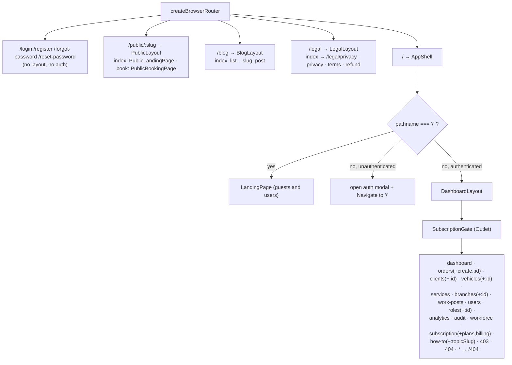

# Frontend Architecture

Two independent React 19 + Vite applications live in this repo. They share no code, no
lockfile, and no build.

| App                | Path                | Purpose                                   | Tenancy                           | Dev port |
| ------------------ | ------------------- | ----------------------------------------- | --------------------------------- | -------- |
| Operator dashboard | `frontend/`         | Staff-facing CRM + marketing/public pages | JWT (`tenantId` inside the token) | 5173     |
| Booking widget     | `frontend-booking/` | Single-tenant customer booking page       | `x-carwash-tenant-id` header      | 5174     |

**Read this when** you are changing UI, routing, data fetching, or the widget contract.
**Entry point:** [README.md](./README.md) · **Screens:** [features.md](./features.md) ·
**Endpoints:** [reference.md](./reference.md)

---

## Operator dashboard (`frontend/`)

### Stack

React 19 · Vite 7 · TailwindCSS 4 (`@tailwindcss/vite`) · React Router 7 (`react-router`) ·
TanStack Query 5 · Zustand 5 · React Hook Form 7 + Zod 4 (`@hookform/resolvers`) ·
axios · socket.io-client · i18next + react-i18next · react-helmet-async · Recharts ·
`@paddle/paddle-js` · `@sentry/react` · sonner (toasts) · lucide-react ·
`@tanstack/react-virtual` · react-markdown. Tests: Vitest + Testing Library + jsdom;
E2E: Playwright.

### Bootstrap chain

```
main.tsx
├── import './shared/lib/sentry'      ← Sentry.init, gated on VITE_SENTRY_DSN
├── './index.css'                     ← Tailwind entry
└── <StrictMode><App /></StrictMode>

app/App.tsx
└── <ErrorBoundary>                   ← root boundary
    └── <Providers>                   ← HelmetProvider ▸ QueryClientProvider ▸ I18nextProvider ▸ <Toaster>
        └── <AppInner>
            ├── useSocket()           ← connects only when authenticated
            ├── useEffect → useAuthStore.bootRefresh()   ← silent refresh before first render
            ├── while !ready → <Skeleton>
            └── <RouterProvider router={router} />
```

`bootRefresh()` runs **before** the router mounts so the first API call already carries a valid
access token — this avoids a race with the 401 refresh interceptor.

### QueryClient defaults (`shared/api/query-client.ts`, mounted by `app/providers.tsx`)

```
queries:   staleTime 30_000 · retry 1 · refetchOnWindowFocus false
mutations: onError → toast.error(...)
           401/403 → generic "Authentication failed. Please check your credentials."
                     (deliberately generic, so backend auth details are not leaked)
           otherwise → the backend `message` (arrays joined with ", ")
```

Because of this global `onError`, **individual mutations do not need their own error toast**.

### Routing (`app/router.tsx`)

`createBrowserRouter`, every page lazily imported and wrapped in
`SuspenseWrapper` (= `ErrorBoundary` + `Suspense` with a skeleton fallback).



Route-level behaviour, precisely:

- **`AppShell`** (`app/layout/AppShell.tsx`) is the only auth gate for dashboard routes. At `/`
  it renders the landing page for everyone. For any other child route it opens the login modal
  (`useAuthModalStore`) and `<Navigate to="/" replace />` when unauthenticated; otherwise it
  renders `DashboardLayout`.
  `shared/components/RequireAuth.tsx` exists but is **not used by the router**.
- **`DashboardLayout`** renders `Sidebar` + `Header` + `SubscriptionGate` + a floating
  `SupportButton`. It handles the mobile (<1024 px) sidebar overlay with a debounced resize
  listener.
- **`SubscriptionGate`** (`shared/components/SubscriptionGate.tsx`) calls
  `GET /subscription/status`. Super admins pass through. While loading it renders a skeleton; on
  error or missing data it passes through (fail-open, so a billing outage cannot lock users out).
  If `isTrial && trialEndsAt` is in the past: users **with** `tenants.read` are redirected to
  `/subscription` unless already on `/subscription`, `/subscription/plans` or
  `/subscription/billing`; users **without** it get a blocking screen.
- **Permission-gated routes**: only the three `/subscription*` routes are wrapped in
  `PermissionGate` (`PERMISSIONS.TENANTS.READ`, fallback `Navigate to="/403"`). Every other
  dashboard route is reachable by any authenticated user; the backend still enforces
  `@Permissions`, and `PermissionGate` is used **inside** pages to hide actions.

### Directory layout

```
frontend/src/
├── main.tsx                     entry
├── app/
│   ├── App.tsx  providers.tsx  router.tsx
│   ├── layout/   AppShell · DashboardLayout · Header · Sidebar · PublicLayout
│   └── pages/    ForbiddenPage · NotFoundPage
├── features/<name>/             api/ · hooks/ · components/ · pages/ · types.ts (+ utils/, constants/)
├── shared/
│   ├── api/client.ts            axios instance + refresh queue + toPaginated + withIdempotencyKey
│   ├── stores/                  auth.store · auth-modal.store · theme.store  (Zustand)
│   ├── hooks/                   useSocket · usePermissions · useBranchScope · useDebounce · useTheme
│   ├── components/              ErrorBoundary · PermissionGate · SubscriptionGate · GlobalSearch ·
│   │                            DataTable · ConfirmDialog · PageHeader · Seo · StatusBadge ·
│   │                            SoftDeleteBadge · IncludeDeletedToggle · LanguageSwitcher · ThemeToggle
│   ├── ui/                      primitive components (Tailwind + cva)
│   ├── constants/               permissions.ts · routes.ts · order-status.ts
│   ├── types/                   api.ts · auth.ts · models.ts · enums.ts
│   └── utils/                   cn · format · idempotency
├── i18n/                        index.ts + locales/{en,uk}/*.json (18 namespaces each)
└── test/                        Vitest setup
```

Feature folders (21): `analytics`, `audit`, `auth`, `blog`, `branches`, `clients`, `dashboard`,
`how-to`, `landing`, `legal`, `orders`, `payments`, `public-booking`, `roles`, `services`,
`subscription`, `support`, `users`, `vehicles`, `work-posts`, `workforce`.

Convention inside a feature: `api/*.api.ts` (raw axios calls + payload types) →
`hooks/use*.ts` (TanStack Query wrappers, query keys, invalidation) → `components/` and
`pages/`. Pages never call axios directly.

### API client (`shared/api/client.ts`)

```ts
axios.create({ baseURL: '/api/v1', withCredentials: true });
```

- **Request interceptor** attaches `Authorization: Bearer <token>` from the in-memory token.
- Requests carry the current auth session version. Responses and retries from a previous
  account/access scope are rejected as cancellation and cannot populate the new account's UI.
- **Response interceptor**, on `401` (and not already retried, and not `/auth/login`
  or `/auth/register`): requests in the same session share one refresh promise. It posts to
  `/api/v1/auth/refresh` with the httpOnly cookie; on success, it updates auth and replays the
  original request. A failure logs out and redirects only while that session still owns the
  operation, so an old failure cannot log out a newly signed-in account.
- Login/register begin an auth transition and clear the old session/cache **before** waiting
  to dispatch. Requests from the previous generation cannot start a late refresh; new
  `apiClient` requests are cancelled while the transition is pending.
- All cookie writers (login/register, boot refresh, 401 refresh and logout) start lazily through
  one serialized queue. Login/register hold a lease until their response interceptor has
  applied the auth response or handled failure, then release it. This keeps browser-cookie
  order aligned with the active session, including a late 401 during account switching.
- Responses with status ≥ 500 are reported to Sentry with url/method/status context.
- The backend `message` is copied onto `error.message` so callers get a readable string.
- `withIdempotencyKey(config)` adds `idempotency-key: crypto.randomUUID()`.
- `toPaginated(resp)` converts the flat backend envelope (`{ data: [...], meta: { total, page,
limit, totalPages } }`) into `{ items, meta }` — see
  [architecture.md](./architecture.md#response-envelope).

### Auth and token handling (`shared/stores/auth.store.ts`)

| Item          | Where it lives                                                                                   | Why                                                                    |
| ------------- | ------------------------------------------------------------------------------------------------ | ---------------------------------------------------------------------- |
| Access token  | Module-scoped variable `_accessToken`                                                            | **Never** in localStorage/sessionStorage — XSS cannot exfiltrate it    |
| Refresh token | httpOnly cookie `refresh_token`, path `/api/v1/auth`, `sameSite: strict`, `secure` in production | Not reachable from JS                                                  |
| User profile  | `localStorage['user']`, validated by `isValidAuthUser` on read                                   | Lets the router know "probably logged in" before the refresh completes |
| Permissions   | Decoded from the JWT payload (`decodeJwtPayload`)                                                | Mirrors the backend `permissions[]` claim                              |

`isAuthenticated` is initialised from the stored user, then corrected by `bootRefresh()`.
`logout()` clears token, profile, permissions and both TanStack Query caches immediately,
then calls `POST /auth/logout` with raw axios (avoiding a circular import with `apiClient`).
`setAuth` / `setPermissions` clear caches and advance the session version when user, tenant,
branch, super-admin status or effective permissions change; same-scope token refresh preserves
cache. Clearing cancels/destroys queries so old promises cannot update successor caches.
Boot refresh applies its result only to its original session. Auth responses tag their user
objects with generation/token ownership in a WeakMap, so a delayed caller cannot reapply an
old `setAuth`. Even a superseded successful response can have changed the browser cookie:
its actual cookie-owner token is remembered, and a queued logout revokes that account,
including logout during an in-flight login. Failed login/register leaves local state cleared
and queues logout for cookie cleanup through the same queue. The focused
`playwright.auth-cookie-ordering.config.ts` uses real browser cookies with synthetic API
responses on `127.0.0.1:5179` and isolated `test-results/auth-cookie-ordering` output.

`usePermissions()` reads the decoded permission list; `PermissionGate` renders `children` or a
`fallback`. This is **UI convenience only** — authorization is enforced server-side.

### Realtime (`shared/hooks/useSocket.ts`)

Connects to the `/events` namespace with `auth: { token }` and `transports: ['websocket']`,
reconnecting up to 10 times with a 1 s delay. Disconnects whenever the user logs out.
Every handler is a **cache invalidation**, not a state patch:

| Socket event           | Invalidated query keys                                                        |
| ---------------------- | ----------------------------------------------------------------------------- |
| `order.created`        | `['orders']`, `['dashboard']`                                                 |
| `order.status_changed` | `['orders']`, `['dashboard']`                                                 |
| `order.cancelled`      | `['orders']`, `['dashboard']`                                                 |
| `payment.received`     | `['payments']`, `['orders']`, `['dashboard','kpi']`, `['dashboard','alerts']` |
| `booking.confirmed`    | `['orders']`                                                                  |

`payment.received` and `booking.confirmed` currently have **no backend emitter on the socket
path** (see [architecture.md](./architecture.md#event-catalogue)) — the listeners are ready for
when one is added.

### i18n

`i18n/index.ts` imports every namespace JSON **statically** for both `en` and `uk` and passes
them to `i18n.use(initReactI18next).init(...)`. 18 namespaces per language: `common`, `auth`,
`orders`, `nav`, `services`, `branches`, `clients`, `dashboard`, `analytics`, `audit`,
`vehicles`, `work-posts`, `workforce`, `public-booking`, `how-to`, `subscription`, `roles`,
`landing`. Adding a namespace means editing `i18n/index.ts` in three places (import, `en`
block, `uk` block).

### Error handling layers

1. Root `<ErrorBoundary>` in `App.tsx`.
2. Per-route `SuspenseWrapper` → `<ErrorBoundary>` around each lazy page.
3. `<ErrorBoundary>` inside `SubscriptionGate` around the `Outlet`.
4. Global mutation `onError` toast.
5. `apiClient` 401 refresh-and-retry, then redirect to `/login`.

### Content and SEO

- **Blog**: `features/blog/blog-loader.ts` uses `import.meta.glob('/content/blog/*.md', { query:
'?raw', eager: true })` with a hand-rolled frontmatter parser (`title`, `date`,
  `description`, `image`, `lang`). Posts are bundled at build time from `frontend/content/blog/`
  (27 markdown files, EN + UK).
- **Meta**: `shared/components/Seo.tsx` (react-helmet-async) sets title/description/canonical/OG
  and emits Article + Breadcrumb JSON-LD. `BASE_URL` is hard-coded to
  `https://washflow.solutions`.
- **Prerender**: `frontend/scripts/prerender-meta.mjs` runs as the last step of `pnpm build`
  (`tsc -b && vite build && node scripts/prerender-meta.mjs`). It rewrites `<head>` **as a
  string** into `dist/<route>/index.html` for public routes so social scrapers and non-JS
  crawlers see per-route metadata. It never renders React, so it cannot crash the build.
  nginx's `try_files $uri $uri/ /index.html` serves those files.

### Global search

`shared/components/GlobalSearch.tsx` fires three parallel `apiClient.get` calls —
`/clients`, `/orders`, `/services` — and renders type-badged results.

### Feature-to-endpoint map

| Feature folder                       | Backend endpoints used                                                                                                                                                                                    | Backend module       |
| ------------------------------------ | --------------------------------------------------------------------------------------------------------------------------------------------------------------------------------------------------------- | -------------------- |
| `auth`                               | `/auth/login`, `/auth/register`, `/auth/forgot-password`, `/auth/reset-password`, `/auth/change-password`, `/users/:id/reset-password`                                                                    | auth, users          |
| `dashboard`                          | `/analytics/dashboard`, `/analytics/kpi`, `/analytics/live`, `/analytics/revenue`, `/analytics/services`, `/analytics/branches`, `/analytics/employees`, `/analytics/alerts`, `/analytics/online-booking` | analytics            |
| `analytics`                          | `/analytics/revenue`, `/analytics/services`                                                                                                                                                               | analytics            |
| `orders`                             | `/orders`, `/orders/:id`, `/orders/:id/status`, `/orders/:id/restore`, `/orders/availability`                                                                                                             | orders, scheduling   |
| `payments`                           | `/orders/:orderId/payments`                                                                                                                                                                               | payments             |
| `clients`                            | `/clients`, `/clients/:id`, `/clients/:id/restore`, `/clients/merge`                                                                                                                                      | clients              |
| `vehicles`                           | `/vehicles`, `/vehicles/:id`, `/vehicles/:id/restore`                                                                                                                                                     | vehicles             |
| `services`                           | `/services`, `/services/:id`, `/services/:id/restore`                                                                                                                                                     | services             |
| `branches`                           | `/branches`, `/branches/:id`, `/branches/:id/restore`, `/branches/:id/booking-settings`, `/work-posts`                                                                                                    | branches, work-posts |
| `work-posts`                         | `/work-posts`, `/work-posts/:id`                                                                                                                                                                          | work-posts           |
| `users`                              | `/users`, `/users/:id`, `/users/:id/restore`                                                                                                                                                              | users                |
| `roles`                              | `/roles`, `/roles/:id`, `/roles/:id/restore`, `/roles/:id/permissions`, `/permissions`                                                                                                                    | roles, permissions   |
| `workforce`                          | `/workforce/profiles`, `/workforce/profiles/:id`                                                                                                                                                          | workforce            |
| `audit`                              | `/audit-logs`                                                                                                                                                                                             | audit                |
| `subscription`                       | `/subscription/status`, `/usage`, `/plans`, `/billing`, `/transactions`, `/checkout`, `/change-plan`, `/addons`, `/preview`, `/cancel`, `/reactivate`                                                     | subscriptions        |
| `support`                            | `/support`                                                                                                                                                                                                | support              |
| `public-booking`                     | `/public/booking/:slug/{availability,services,branches,book}` via its own axios instance (`baseURL: '/api/v1/public/booking'`, no auth header)                                                            | public-booking       |
| `blog`, `legal`, `landing`, `how-to` | none — static/bundled content                                                                                                                                                                             | —                    |

**Backend endpoints with no dashboard caller** (verified by grep): `/analytics/export/orders`,
`/analytics/export/clients`, `/vehicles/:id/photo`, `/tenants*`, `/health`, `/metrics`,
`/public/widget/*`. They are reachable, just not wired into this UI.

### Build and runtime configuration

| Variable              | Consumed by                                                    | Notes                                                                                                                                                                                                                                                                                                                                                                        |
| --------------------- | -------------------------------------------------------------- | ---------------------------------------------------------------------------------------------------------------------------------------------------------------------------------------------------------------------------------------------------------------------------------------------------------------------------------------------------------------------------- |
| `VITE_SENTRY_DSN`     | `shared/lib/sentry.ts`; Docker build arg                       | Empty → `Sentry.init` is skipped entirely. When set: `sendDefaultPii: false`, browser tracing + replay, `tracesSampleRate` 0.2 in prod / 1.0 in dev, `replaysSessionSampleRate` 0.1 / 1.0, `replaysOnErrorSampleRate` 1.0. **CI does not pass this build arg**, so the published image ships with it empty — see [infrastructure.md](./infrastructure.md#images-and-startup) |
| `VITE_PADDLE_SANDBOX` | Paddle checkout components; Docker build arg (CI sets `false`) | Build-time only                                                                                                                                                                                                                                                                                                                                                              |

Vite dev server: port **5173**, proxying `/api` and `/socket.io` (with `ws: true`) to
`http://localhost:3003`. Manual vendor chunks are configured in `vite.config.ts`
(`react-vendor`, `ui-vendor`, `data-vendor`, `form-vendor`, `i18n-vendor`, `charts-vendor`).

Production image: `frontend/Dockerfile` — `node:20-alpine` build stage → `nginx:alpine` serving
`/usr/share/nginx/html` with `frontend/nginx.conf` (gzip; `X-Frame-Options`,
`X-Content-Type-Options`, `Referrer-Policy`; `/api` and `/socket.io` proxied to `backend:3000`;
`/assets` cached 1 year immutable; SPA fallback with `no-cache` on `index.html`).

### Tests

- Vitest (`vitest.config.ts`, jsdom) — co-located `__tests__/` folders under
  `shared/api`, `shared/hooks`, `shared/stores`, `shared/components`, `shared/constants`,
  `shared/utils`.
- Playwright (`playwright.config.ts`) — `testDir: ./e2e`, `baseURL http://localhost:5173`,
  `workers: 1`, `fullyParallel: false`, retries 2 in CI. Projects: `setup`,
  `setup-registration`, `setup-roles`, then `chromium` (admin), `fresh-tenant`,
  `role-operator`, `role-receptionist`, `role-manager`. `webServer` runs `pnpm dev` and reuses
  an already-running server. Credentials come from `frontend/.env.test`
  (`PLAYWRIGHT_EMAIL`, `PLAYWRIGHT_PASSWORD`, `PLAYWRIGHT_TENANT_ID`) — that file is
  **gitignored**, so create it locally before running the suite.

---

## Booking widget (`frontend-booking/`)

A deliberately minimal, **single-tenant** public app. No auth, no sockets, no Sentry, no
Zustand, no Recharts, no Helmet.

### Tenant contract — the important part

```ts
// src/config/tenant.ts — runs at module load
const tenantId = import.meta.env.VITE_TENANT_ID;
if (!tenantId || !UUID_REGEX.test(tenantId)) {
  throw new Error(
    'VITE_TENANT_ID is missing or not a valid UUID. Set it in your .env file.',
  );
}
export const TENANT_ID: string = tenantId;
```

```ts
// src/api/booking.api.ts
axios.create({
  baseURL: `${import.meta.env.VITE_API_BASE_URL || ''}/api/v1/public/widget`,
  headers: {
    'Content-Type': 'application/json',
    'x-carwash-tenant-id': TENANT_ID,
  },
});
```

- `VITE_TENANT_ID` is **baked into the bundle at build time**. One build = one car wash.
  Rotating a tenant means rebuilding and redeploying.
- The header name `x-carwash-tenant-id` must match `@Headers('x-carwash-tenant-id')` in
  `src/modules/public-booking/public-booking-header.controller.ts` **and** the CORS
  `allowedHeaders` list in `src/main.ts`. Changing it requires touching all three.
- The backend validates the header as a UUID and resolves an **active** tenant, else `404`.
- `createBooking` sends `idempotency-key: crypto.randomUUID()` on every submit.
- A tenant id in a public bundle is not a secret — it is an identifier. All widget endpoints are
  `@Public()` and rate-limited server-side.

### Structure and routing

```
frontend-booking/src/
├── main.tsx · app/{App,providers,router}.tsx
├── config/tenant.ts        VITE_TENANT_ID guard
├── api/booking.api.ts      fetchServices · fetchBranches · fetchAvailability · createBooking
├── hooks/usePublicBooking.ts
├── layout/BookingLayout.tsx  header + EN/UK toggle + <Outlet>
├── pages/BookingPage.tsx     the whole wizard (~780 lines)
├── i18n/                     index.ts + locales/{en,uk}/public-booking.json  (1 namespace)
├── types/{api,models}.ts
├── ui/                       button · card · date-picker · input · label · select · skeleton
└── utils/{cn,format}.ts
```

The router has **exactly one route**: `BookingLayout` with an `index` element of `BookingPage`.
There is no `/book` sub-route. `BookingPage` is a **3-step** wizard driven by local `useState`:

| Step | Label (i18n key) | Content                                 |
| ---- | ---------------- | --------------------------------------- |
| 0    | `steps.services` | Branch + services + date/time selection |
| 1    | `steps.yourInfo` | Contact details and vehicle             |
| 2    | `steps.confirm`  | Review + submit                         |

Providers: `QueryClientProvider` (`retry: 1`, `refetchOnWindowFocus: false`) + sonner
`<Toaster>`. i18n has a single `public-booking` namespace and a header language toggle.

### Configuration

| Variable            | Required | Effect                                                    |
| ------------------- | -------- | --------------------------------------------------------- |
| `VITE_TENANT_ID`    | **yes**  | Must be a UUID; the app throws at startup otherwise       |
| `VITE_API_BASE_URL` | no       | Empty → relative `/api/v1/...` (same-origin or dev proxy) |
| `VITE_DEFAULT_LANG` | no       | Listed in `.env.example`                                  |

Dev server: port **5174**, `/api` proxied to `http://localhost:3003`.
Build: `tsc -b && vite build` → `dist/`. Playwright config and an `e2e/` folder exist; there is
no unit-test setup.

**Not evidenced in this repo:** any Dockerfile, nginx config, or CI job for
`frontend-booking/`. CI builds and pushes only the backend and `frontend/` images. How the
widget is hosted is unknown — see
[infrastructure.md](./infrastructure.md#8-known-unknowns).

---

## Comparing the three booking surfaces

| Surface                        | Lives in            | Tenant resolution                  | Backend routes                           |
| ------------------------------ | ------------------- | ---------------------------------- | ---------------------------------------- |
| `/public/:slug` page           | `frontend/`         | URL slug                           | `/api/v1/public/booking/:slug/*`         |
| Standalone widget              | `frontend-booking/` | `x-carwash-tenant-id` (build-time) | `/api/v1/public/widget/*`                |
| Operator "create order" wizard | `frontend/`         | JWT                                | `/api/v1/orders`, `/orders/availability` |

The first two are two thin controllers over the **same** `PublicBookingService` `*Internal`
methods, so a change to booking rules affects both. Both clients consume the narrow
`BookingConfirmationDto`: booking/branch/service information plus the submitted contact and
vehicle identity, with no stored CRM identity or staff relations.

Both public wizards bind the selected time to the booking surface, branch, service selection
and date; the dashboard also includes its tenant slug. Changing that context clears the
selection synchronously; moving forward or submitting requires it to match the current
context and available slots. Pending
availability fetches, failures and removed slots block progression. Async form validation that
finishes after the context changes cannot submit the old selection, including an A→B→A switch;
late availability responses cannot revive it. Targeted Playwright configs
(`playwright.booking-selection.config.ts` in each frontend) exercise these races with
intercepted synthetic API responses and require no real booking writes.

---

Related: [features.md](./features.md) · [reference.md](./reference.md) ·
[architecture.md](./architecture.md) · [infrastructure.md](./infrastructure.md)
