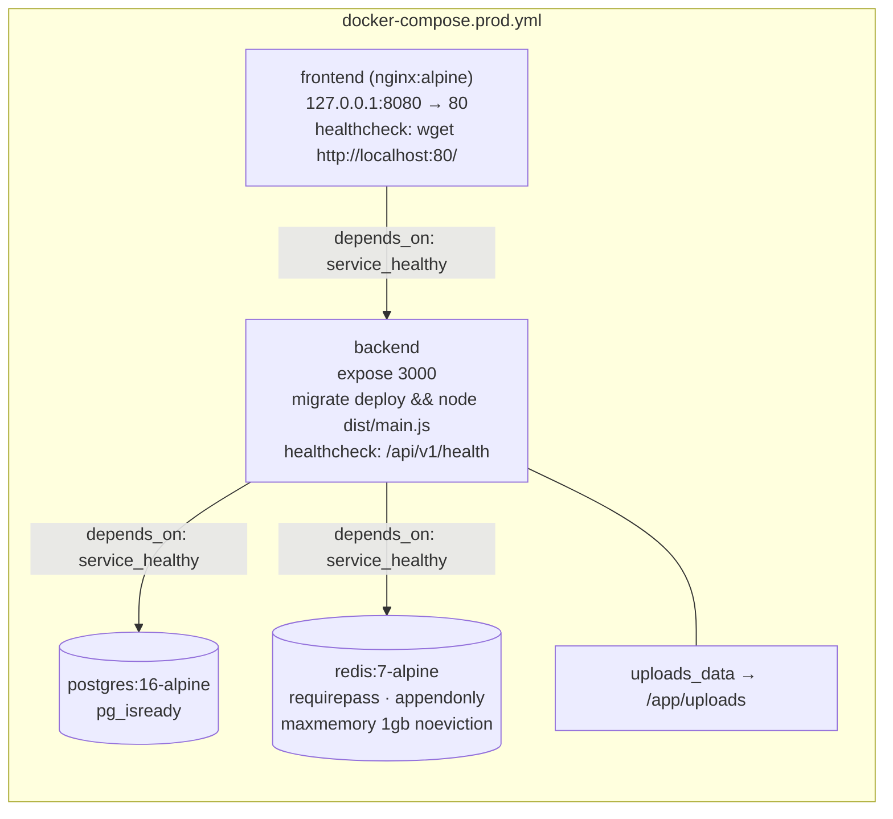
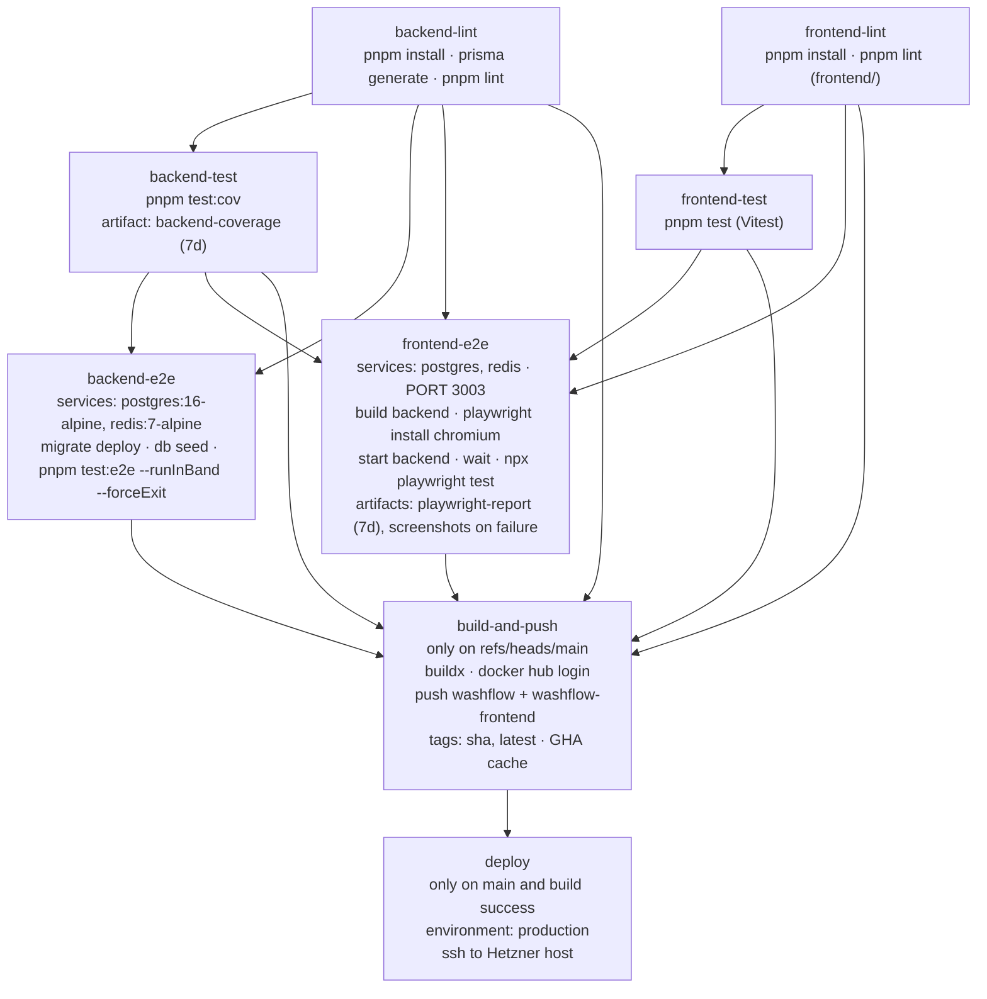

# Infrastructure & Operations

Everything about running WashFlow: local setup, Docker variants, environment variables, CI,
observability, external integrations, and what this repository does **not** tell you.

**Read this when** you touch Compose files, the Dockerfiles, env validation, CI, or need to
diagnose a running system.
**Entry point:** [README.md](./README.md) · **Contributor workflow:** [../CONTRIBUTING.md](../CONTRIBUTING.md)

> **Secrets:** this document names variables. It never contains values. `.env` and `.env.docker`
> are gitignored; `.env.example` and `.env.docker.example` carry placeholders only. Never copy
> a real value into documentation, a commit message, or a log.

---

## 1. Local setup

### Prerequisites

Node.js 20+ · pnpm 9 (`corepack enable`) · Docker + Docker Compose · PostgreSQL 16 and
Redis 7 (or use `docker-compose.dev.yml`).

### First run

```bash
# 1. Dependencies — three separate installs, three separate lockfiles
pnpm install
cd frontend && pnpm install && cd ..
cd frontend-booking && pnpm install && cd ..     # only if you work on the widget

# 2. Infrastructure (PostgreSQL + Redis only)
docker compose -f docker-compose.dev.yml up -d

# 3. Environment
cp .env.example .env         # then fill DATABASE_URL / REDIS_URL / the two JWT secrets

# 4. Database
npx prisma generate
npx prisma migrate deploy    # or `npx prisma migrate dev` while iterating on the schema
npx prisma db seed           # optional demo data; idempotent

# 5. Run
pnpm start:dev                              # backend
cd frontend && pnpm dev                     # dashboard  → http://localhost:5173
cd frontend-booking && pnpm dev             # widget     → http://localhost:5174
```

Run dev servers in tmux so their logs stay readable after you detach:

```bash
tmux new -s dev 'pnpm start:dev'
tmux attach -t dev
```

### Ports, and the 3000 vs 3003 split

| Where                                   | Port                             | Source                                                       |
| --------------------------------------- | -------------------------------- | ------------------------------------------------------------ |
| Backend default                         | `3000`                           | `PORT` default in `src/config/env.validation.ts`             |
| Backend in `docker-compose.yml`         | `3000:3000`                      | `docker-compose.yml`                                         |
| Backend in `docker-compose.prod.yml`    | `expose: 3000` (no host publish) | `docker-compose.prod.yml`                                    |
| Dashboard Vite dev server               | `5173`                           | `frontend/vite.config.ts`                                    |
| Widget Vite dev server                  | `5174`                           | `frontend-booking/vite.config.ts`                            |
| **Both Vite proxies target**            | **`http://localhost:3003`**      | `frontend/vite.config.ts`, `frontend-booking/vite.config.ts` |
| CI `frontend-e2e` starts the backend on | `3003`                           | `.github/workflows/ci.yml`                                   |
| PostgreSQL (dev + default compose)      | host `5433` → container `5432`   | `docker-compose.dev.yml`, `docker-compose.yml`               |
| PostgreSQL (prod compose)               | not published                    | `docker-compose.prod.yml`                                    |
| Redis                                   | `6379`                           | dev + default compose (prod does not publish)                |
| Frontend nginx (prod)                   | `127.0.0.1:8080` → `80`          | `docker-compose.prod.yml`                                    |

**Set `PORT=3003` in your local `.env`** if you want the Vite proxies to reach the backend
without editing config. If you prefer 3000, change the two `vite.config.ts` proxy targets
instead — but note CI pins 3003 for the Playwright job.

The root `README.md` and `docs/CONTRIBUTING.md` are aligned with the 3003 convention.

---

## 2. Compose variants

| File                      | Services                                   | Persistence                                   | Intended use                               |
| ------------------------- | ------------------------------------------ | --------------------------------------------- | ------------------------------------------ |
| `docker-compose.dev.yml`  | `postgres`, `redis`                        | volume `postgres_dev` (Redis is ephemeral)    | Local infra while you run Node on the host |
| `docker-compose.yml`      | `postgres`, `redis`, `backend`             | `postgres_data`, `redis_data`                 | Whole backend stack locally in Docker      |
| `docker-compose.prod.yml` | `postgres`, `redis`, `backend`, `frontend` | `postgres_data`, `redis_data`, `uploads_data` | Production (used by the deploy job)        |



Startup order is enforced by `depends_on: condition: service_healthy`:
**postgres + redis → backend → frontend**.

Production Redis uses `maxmemory-policy noeviction` with `maxmemory 1gb`: BullMQ jobs and
webhook idempotency keys cannot disappear through cache eviction. Once memory is exhausted,
new writes may fail with OOM. Monitor memory, failed queue writes and health; reduce cache
pressure or provision capacity rather than changing the queue store to an eviction policy.

### Required-variable guards

`docker-compose.yml` and `docker-compose.prod.yml` use `${VAR:?message}` so Compose refuses to
start when a required value is missing:

- both: `POSTGRES_PASSWORD`, `REDIS_PASSWORD`
- prod additionally: `JWT_ACCESS_SECRET`, `JWT_REFRESH_SECRET`

`docker-compose.dev.yml` intentionally uses a weak default password for local convenience and
publishes Postgres on `5433`.

### Production defaults baked into `docker-compose.prod.yml`

`NODE_ENV=production` · `PORT=3000` · `PADDLE_SANDBOX='false'` · `PAYMENTS_ENABLED` defaults to `false` ·
`CORS_ORIGINS` defaults to `https://washflow.solutions` · `FRONTEND_URL` defaults to
`https://washflow.solutions` · images `${DOCKER_IMAGE:-washflow/app}` and
`${DOCKER_IMAGE_FRONTEND:-washflow/frontend}` tagged `${DOCKER_TAG:-latest}`.

### Images and startup

**Backend — `Dockerfile` (multi-stage, `node:20-alpine`, pnpm 9 via corepack)**

1. _builder_: `pnpm install --frozen-lockfile` → `prisma generate` (with a dummy
   `DATABASE_URL`) → `pnpm build` → compile `prisma/seed.ts` to `dist/` with a standalone
   `tsc` invocation (because `nest build` only compiles `src/`).
2. _production_: `pnpm install --frozen-lockfile --prod`, copy `dist/`, `prisma/` and
   `prisma.config.ts`, re-run `prisma generate` against the production `node_modules`, create
   `/app/uploads/vehicles`, drop to a non-root `app` user, `EXPOSE 3000`,
   `CMD ["node", "dist/main.js"]`.

Both Compose files override the command with
`sh -c "npx prisma migrate deploy && node dist/main.js"`, so **migrations run at container
start**, not at build time.

> `docker-entrypoint.sh` exists at the repo root and does something different —
> `prisma db push --skip-generate --accept-data-loss` followed by `node dist/src/main.js`. **No
> Compose service and no Dockerfile references it**, and its path (`dist/src/main.js`) does not
> match the Dockerfile's (`dist/main.js`). Treat it as unused until proven otherwise; do not
> wire it in without checking both facts.

**Frontend — `frontend/Dockerfile`**: `node:20-alpine` build (`ARG VITE_SENTRY_DSN`,
`ARG VITE_PADDLE_SANDBOX`) → `nginx:alpine` serving `dist/` with `frontend/nginx.conf`.

> **The published frontend image has no Sentry DSN.** `build-and-push` passes
> `build-args: VITE_PADDLE_SANDBOX=false` and nothing else, so `VITE_SENTRY_DSN` falls back to
> the Dockerfile's `ARG VITE_SENTRY_DSN=""` and Vite inlines an empty string. The deploy job
> does write `VITE_SENTRY_DSN` into `/opt/washflow/.env`, and `docker-compose.prod.yml` maps it
> into the `frontend` service's `build.args` — but deploy **pulls** the prebuilt image and never
> builds, so that value is never consumed. Dashboard Sentry is effectively off in production
> until the CI build args (or a build-on-host deploy) are extended. Backend Sentry is
> unaffected: `SENTRY_DSN` is a plain runtime environment variable.

**Seeding** is never automatic. `docker-compose.yml` documents the manual form:

```bash
docker compose run --rm backend node dist/prisma/seed.js
```

---

## 3. Environment variables

Validated once at startup by `envSchema` in `src/config/env.validation.ts` (Zod). A failure
throws with a formatted, per-field error list and the process does not start. Values are then
mapped to dotted config keys in `src/config/configuration.ts` and read via
`ConfigService.get('<dotted.key>')`.

### Required

| Variable             | Validation         | Config key          |
| -------------------- | ------------------ | ------------------- |
| `DATABASE_URL`       | `z.url()`          | `database.url`      |
| `REDIS_URL`          | `z.url()`          | `redis.url`         |
| `JWT_ACCESS_SECRET`  | `string().min(32)` | `jwt.accessSecret`  |
| `JWT_REFRESH_SECRET` | `string().min(32)` | `jwt.refreshSecret` |

### Server and auth

| Variable                 | Default | Config key              | Notes                                                                      |
| ------------------------ | ------------- | ----------------------- | ---------------------------------------------------------------- |
| `PORT`                   | `3000`        | `port`                  | Coerced to a positive integer                                    |
| `NODE_ENV`               | `development` | `nodeEnv`               | `development` \| `production` \| `test`                          |
| `CORS_ORIGINS`           | `*`           | `corsOrigins`           | Comma-separated. **`*` + `NODE_ENV=production` ⇒ process exits** |
| `JWT_ACCESS_EXPIRATION`  | `15m`         | `jwt.accessExpiration`  |                                                                  |
| `JWT_REFRESH_EXPIRATION` | `7d`          | `jwt.refreshExpiration` | The refresh cookie's own `maxAge` is hard-coded to 7 days        |

### Billing (Paddle)

| Variable                 | Default | Config key              | Notes                                                                      |
| ------------------------ | ------- | -------------------------- | ------------------------------------------------------------------------------------------------------------------------------------------------------------------------------------------- |
| `PADDLE_API_KEY`         | —       | `paddle.apiKey`            | All three credentials must be nonblank when payments are enabled; partial sets are always rejected (`superRefine`) |
| `PADDLE_CLIENT_TOKEN`    | —       | `paddle.clientToken`       | Returned to the browser for the checkout overlay                         |
| `PADDLE_WEBHOOK_SECRET`  | —       | `paddle.webhookSecret`     | HMAC-SHA256 verification of `Paddle-Signature`                           |
| `PADDLE_SANDBOX`         | `true`  | `paddle.sandbox`           | `'true'`/`'false'` string → boolean                                      |
| `PADDLE_PRICE_IDS`       | `{}`    | `paddle.priceIds`          | JSON object, string values only; parse errors are explicit               |
| `PADDLE_ADDON_PRICE_IDS` | `{}`    | `paddle.addonPriceIds`     | Same validation                                                          |
| `PAYMENTS_ENABLED`       | `false` | `features.paymentsEnabled` | Only explicit `true` / `false` accepted; enabling requires all three nonblank Paddle credentials in every environment; production Compose passes this variable through with a false default |

### Email, support, frontend link

| Variable                 | Default | Config key              | Notes                                                                      |
| -------------------------- | --------------------------------------- | ------------------------ | --------------------------------------------------- |
| `RESEND_API_KEY`           | `''`                                    | `resend.apiKey`          | Empty → `EmailService` no-ops                       |
| `EMAIL_FROM`               | `WashFlow <noreply@washflow.solutions>` | `resend.from`            |                                                     |
| `FRONTEND_URL`             | `http://localhost:5173`                 | `frontendUrl`            | Used to build password-reset links                  |
| `TELEGRAM_BOT_TOKEN`       | `''`                                    | `telegram.botToken`      | Empty → support requests are dropped with a warning |
| `TELEGRAM_SUPPORT_CHAT_ID` | `''`                                    | `telegram.supportChatId` | Both are required for the relay to work             |

### Observability

| Variable                 | Default | Config key              | Notes                                                                      |
| --------------------------- | ---------------------------------- | -------------------------------- | -------------------------------------------------------- |
| `SENTRY_DSN`                | —                                  | read directly in `instrument.ts` | Absent → `Sentry.init` is skipped                        |
| `SENTRY_TRACES_SAMPLE_RATE` | `0.05` prod / `1.0` dev (computed) | `instrument.ts`                  | Zod-validated to 0–1                                     |
| `METRICS_TOKEN`             | `''`                               | `metricsToken`                   | Empty **denies** `/metrics` in production, allows in dev |
| `GRAFANA_LOKI_HOST`         | `''`                               | `grafanaLoki.host`               | Must be a URL when non-empty                             |
| `GRAFANA_LOKI_USERNAME`     | `''`                               | `grafanaLoki.username`           | All three required together for shipping to activate     |
| `GRAFANA_LOKI_PASSWORD`     | `''`                               | `grafanaLoki.password`           |                                                          |

### Housekeeping

| Variable                 | Default | Config key              | Notes                                                                      |
| ------------------------ | ------- | ----------------------- | -------------------------------------------------------------------------- |
| `CLEANUP_RETENTION_DAYS` | `30`    | `cleanup.retentionDays` | Optional in Zod; `configuration.ts` reads `process.env` and `parseInt`s it |

### Compose-only variables (not read by the app)

`POSTGRES_DB`, `POSTGRES_USER`, `POSTGRES_PASSWORD`, `REDIS_PASSWORD`, `DOCKER_IMAGE`,
`DOCKER_IMAGE_FRONTEND`, `DOCKER_TAG` — consumed by the Compose files to build
`DATABASE_URL`/`REDIS_URL` and select images.

### Frontend build-time variables

`VITE_SENTRY_DSN`, `VITE_PADDLE_SANDBOX` (dashboard) · `VITE_TENANT_ID`, `VITE_API_BASE_URL`,
`VITE_DEFAULT_LANG` (widget). Vite inlines these at build time — anything prefixed `VITE_` is
public. Setting one in `/opt/washflow/.env` does nothing for an image that was already built;
CI passes only `VITE_PADDLE_SANDBOX` (see [§2](#images-and-startup)).
See [frontend.md](./frontend.md#build-and-runtime-configuration).

### Adding a variable — the full checklist

1. `src/config/env.validation.ts` — add to `envSchema`.
2. `src/config/configuration.ts` — expose it under a dotted key.
3. `.env.example` (and `.env.docker.example` if it is Compose-relevant) — placeholder only.
4. `docker-compose.prod.yml` — pass it through to the `backend` service.
5. `.github/workflows/ci.yml` — add synthetic E2E values if required; deployment preserves
   live server settings, so production configuration changes are separate operator work.
6. This document's tables.

---

## 4. CI/CD — `.github/workflows/ci.yml`

**Triggers:** push to `main`, PRs targeting `main`, and `workflow_dispatch` with boolean inputs
`skip_unit_tests` and `skip_e2e`.
**Concurrency:** `${{ github.workflow }}-${{ github.ref }}`, `cancel-in-progress: true`.
**Permissions:** `contents: read`. **Node 20, pnpm 9.**



Notes that matter when you read a failed run:

- `backend-lint` runs `pnpm lint`, which is `eslint … --fix`. In CI the working tree is
  disposable, so this is harmless; **locally it rewrites your files**. Use a no-fix invocation
  when you only want to check — see
  [agent-playbook.md](./agent-playbook.md#lint-format-and-type-checks).
- Skip inputs are independent. E2E jobs use explicit `always() && !cancelled()` gates and
  require successful lint; they accept skipped unit dependencies only when `skip_unit_tests`
  requested that skip. Skipping unit tests alone therefore still runs E2E.
- `build-and-push` requires main, successful lint and successful test dependencies, accepting
  each skipped test job only when its matching explicit skip input allows it. Failure,
  cancellation, or an unintended skip blocks publishing. Deploy requires build-and-push success.
- Both E2E jobs run `npx prisma db seed` with `continue-on-error: true`.
- `backend-e2e` sets `NODE_ENV=test`, which makes `ThrottlerModule.forRoot([])` a no-op
  (rate limiting is deliberately disabled for E2E).
- The E2E jobs use dedicated, non-secret CI JWT values and three synthetic sandbox Paddle
  credentials defined inline in the workflow. They explicitly enable payments to preserve
  payment guard/UI coverage while satisfying enabled-payment startup validation; these values
  are test fixtures and do not establish access to Paddle.
- `build-and-push` passes `build-args: VITE_PADDLE_SANDBOX=false` to the frontend image and
  **no other build arg** — notably not `VITE_SENTRY_DSN`. See
  [§2](#images-and-startup) for what that means in production.
- The deploy job preserves live `/opt/washflow/.env` and `docker-compose.yml`. It checks the
  existing project, capacity, full migration checksums and public-schema catalog against a
  fresh isolated PG16 reference. Images use full commit-SHA tags, then resolved immutable
  image IDs after revision/platform checks. A quiesced paired database/uploads backup is
  mandatory before app-only recreation. Failure attempts exact-ID app rollback; no pruning,
  `remove-orphans` or configuration/provider changes occur. See the
  [deployment runbook](../operations/deployment.md) for gates, interruption recovery and limits.
- The image override explicitly runs `node dist/main.js` after verifying zero pending
  migrations; the live base Compose migration-start command is preserved. Backend HTTP,
  cron and BullMQ resume together before health. Application rollback cannot undo writes.
- Production settings, including `PAYMENTS_ENABLED` and provider credentials, remain those
  already configured on the server. The deploy job no longer regenerates them from GitHub.

**Deployment secrets referenced:** `DOCKERHUB_USERNAME`, `DOCKERHUB_TOKEN`,
`DEPLOY_SSH_KEY`, `DEPLOY_HOST`, `DEPLOY_USER`. Existing live application credentials are
not read back or rewritten by the job.

`frontend-booking/` has **no CI job and no image build**.

---

## 5. Observability

### Health — `GET /api/v1/health`

`@nestjs/terminus` with three indicators:

| Key        | Indicator                                  |
| ---------- | ------------------------------------------ |
| `database` | `PrismaHealthIndicator.pingCheck`          |
| `redis`    | `RedisHealthIndicator`                     |
| `queues`   | `BullMQHealthIndicator` (the three queues) |

Public (`@Public()`). Used by the `backend` healthcheck in `docker-compose.prod.yml`
(`wget -qO- http://localhost:3000/api/v1/health`) and by the deploy job's readiness loop.

### Metrics — `GET /api/v1/metrics`

`prom-client` registry with Node.js default metrics plus:

| Metric                          | Type      | Labels                                         |
| ------------------------------- | --------- | ---------------------------------------------- |
| `http_request_duration_seconds` | Histogram | `method`, `route`, `status` (buckets 0.01–5 s) |
| `http_requests_total`           | Counter   | `method`, `route`, `status`                    |

`MetricsInterceptor` is registered as a global `APP_INTERCEPTOR` by the `@Global()`
`MetricsModule`. `configuration.ts` maps `METRICS_TOKEN` to `metricsToken`, and production
Compose passes the variable into the backend so `MetricsAuthGuard` can read it. The endpoint
is `@Public()` + `@SkipThrottle()` and guarded by
`MetricsAuthGuard`: with `METRICS_TOKEN` set it requires `Authorization: Bearer <token>`;
without it, **allowed in dev/test, denied in production**.

```yaml
scrape_configs:
  - job_name: washflow-backend
    metrics_path: /api/v1/metrics
    static_configs:
      - targets: ['backend:3000']
    # authorization: { credentials: <METRICS_TOKEN> }   # when the token is configured
```

### Logging

`nestjs-pino` configured in `AppModule`:

- `NODE_ENV !== 'production'` → level `debug`, transport `pino-pretty`.
- production **with** all three Loki variables → two transport targets: `pino-loki`
  (batching, 5 s interval, basic auth, labels `{ app: 'washflow', env: 'production' }`) and
  `pino/file` to stdout.
- production **without** Loki → no transport (plain JSON on stdout), level `info`.

Every log line carries `correlationId` via pino `customProps`.

### Correlation IDs

`CorrelationIdMiddleware` applies to `*`: it reads `x-correlation-id` or generates a
`randomUUID()`, writes it back onto the request headers, sets it as a response header, and
attaches `req.correlationId`.

### Errors — Sentry

Backend: `src/instrument.ts` (imported first by `main.ts`) plus
`SentryModule.forRoot()` as the first `AppModule` import. `sendDefaultPii: false`
unconditionally; Node profiling integration; `tracesSampleRate` and `profileSessionSampleRate`
both from `SENTRY_TRACES_SAMPLE_RATE`, defaulting to 0.05 in production and 1.0 elsewhere.

Frontend: `frontend/src/shared/lib/sentry.ts` — see
[frontend.md](./frontend.md#build-and-runtime-configuration).

---

## 6. External integrations

| Service          | Direction | Where                                                           | Failure mode                                                                                                                                                                                                                                                                                    |
| ---------------- | --------- | --------------------------------------------------------------- | -------------------------------------------------------------------------------------------------------------------------------------------------------------------------------------------------------------------------------------------------------------------------------------------------------------------------------------------------------------- |
| **Paddle**       | out       | `PaddleService` (`fetch` to the Paddle API)                     | Mutations are guarded by `PaymentsEnabledGuard` (503 when `PAYMENTS_ENABLED` is off). Enabling payments without all three nonblank credentials fails startup validation. Configured but invalid credentials can still fail at runtime; a `CircuitBreaker` opens after 5 failures. `PaddlePriceCacheService` (startup + hourly) falls back to hard-coded prices |
| **Paddle**       | in        | `POST /api/v1/webhooks/paddle` (`@Public()`, `@SkipThrottle()`) | Missing header/raw body/invalid HMAC → `400`; duplicate `event_id` → skipped                                                                                                                                                                                                                    |
| **Resend**       | out       | `EmailService`                                                  | No key → silent no-op; failures logged; `CircuitBreaker` opens after 5 failures for 30 s                                                                                                                                                                                                        |
| **Telegram**     | out       | `SupportService`                                                | Unconfigured → warn + drop; 5 s `AbortController` timeout; errors logged                                                                                                                                                                                                                        |
| **Sentry**       | out       | `instrument.ts`, `@sentry/react`                                | No DSN → not initialised                                                                                                                                                                                                                                                                        |
| **Grafana Loki** | out       | `pino-loki` transport                                           | Any of the three vars missing → transport not added                                                                                                                                                                                                                                             |
| **Docker Hub**   | CI        | `build-and-push`                                                | Requires `DOCKERHUB_*` secrets                                                                                                                                                                                                                                                                  |
| **Hetzner host** | CI        | `deploy` (SSH)                                                  | Requires `DEPLOY_*` secrets; health loops fail the job and dump logs                                                                                                                                                                                                                            |

### Paddle webhook specifics

`app.rawBody = true` is set in `NestFactory.create`, and the controller reads
`req.rawBody`. `PaddleWebhookService.verifySignature` parses the `ts=<timestamp>;h1=<hash>`
format, computes `createHmac('sha256', PADDLE_WEBHOOK_SECRET)` and compares with
`timingSafeEqual`. Processing is made idempotent by a Redis `SET … NX` on the event id
(prefix `paddle:webhook:`, 24 h TTL). Handled event types: `subscription.created`,
`subscription.updated`, `subscription.canceled`, `subscription.past_due`,
`subscription.paused`, `subscription.resumed`, `transaction.completed`.

---

## 7. Data lifecycle

| Concern                | Mechanism                                                                                             |
| ---------------------- | ----------------------------------------------------------------------------------------------------- |
| Schema migrations      | `prisma migrate deploy` at container start (both Compose files). Forward-only.                        |
| Local schema iteration | `npx prisma migrate dev`                                                                              |
| CI database            | `pnpm exec prisma migrate deploy` on fresh PostgreSQL service databases (both E2E jobs)                          |
| Seeding                | `npx prisma db seed` → `ts-node prisma/seed.ts`; idempotent, fixed demo tenant id                     |
| Reset (local only)     | `pnpm db:reset` = `npx prisma migrate reset` — **destructive**                                        |
| Soft-delete retention  | `CleanupService` daily at 02:00, `CLEANUP_RETENTION_DAYS` (default 30), one FK-ordered `$transaction` |
| Idempotency keys       | `IdempotencyCleanupService` hourly; rows have a 24 h TTL                                              |
| Uploads                | `uploads_data` volume mounted at `/app/uploads`; served from `/uploads`                               |

Local PostgreSQL 16 custom-format backup, paired quiesced uploads, guarded new-target restore,
an isolated synthetic drill and operator recovery decisions are documented in the
[backup/recovery runbook](../operations/backup-recovery.md). The tools are local preparation;
production schedules, offsite copies, encryption and PostgreSQL PITR are not activated.

---

### Verified migration/schema drift

The first 14 migrations had verified drift from `prisma/schema.prisma`: missing
`branches.timezone`, `vehicles.photo_url` versus `photoUrl`, 35 legacy timestamp columns,
seven missing indexes and four obsolete subscription-limit defaults. Forward migration
`20261015000000_reconcile_schema_drift` repairs that drift without editing migration history.
A new PostgreSQL 16 database built with all 15 migrations now produces an empty
`prisma migrate diff --from-config-datasource --to-schema prisma/schema.prisma --script
--exit-code --config test/repair-prisma.config.ts` (exit 0).

The migration renames the existing photo column, defaults existing/new branches to
`Europe/Kyiv` when adding the missing column, and preserves an already-present timezone.
If both photo spellings exist, it aborts before changing anything; reconcile that ambiguity
before retrying. It converts only the 35 listed `timestamp without time zone` columns using
explicit `AT TIME ZONE 'UTC'`, preserving the instants the current Prisma PostgreSQL adapter
returns for legacy timestamps. Already-`timestamptz` columns are untouched. Historical writer
and session timezone conventions in production have not been inspected; confirm that UTC
interpretation against a backup before applying to real data.

Existing subscription limit values are unchanged; omitted future limits become `NULL`, as
in the schema. The tenant index on `order_services` and the partial trial-expiry index on
`subscriptions` are preserved and declared in the schema. Prisma 7.4's `partialIndexes`
preview feature represents the existing predicate; no dependency upgrade is needed.

This is an atomic maintenance migration with a 10-second lock-acquisition timeout. Timestamp
table rewrites and index builds take write locks, so plan a maintenance window appropriate
to database size. A lock timeout rolls the transaction back; investigate contention before
retrying. `migrate deploy` records failures: inspect the failed migration and database first,
then use Prisma's documented failed-migration recovery process; do not reset or `db push`
an existing database.

`test/migration-drift.e2e-spec.ts` reproduces the missing-column failure on the old chain and
checks upgrades of a synthetic graph spanning all 20 tables in Los Angeles and Tokyo sessions.
It compares all row values with timestamps normalized to epochs, including milliseconds,
already-zoned microseconds, DST-boundary values, NULLs, money, tenant/FK references, enums and
photo contents. It also checks the default timezone/limits, custom timezone retention,
partial-index predicate, already-corrected column shapes and atomic rejection of ambiguous
photo columns. See [the isolated test workflow](../CONTRIBUTING.md#isolated-postgresql-concurrency-checks).
No production database or data was modified by these checks.

---

The isolated critical-workflow harness in `test/p0-critical-harness.ts` uses the same
`WASHFLOW_REPAIR_TEST_DATABASE_URL` guard as the repair concurrency suite. It constructs only
controllers and real domain services with synthetic signed auth contexts; no application
bootstrap, `.env`, Redis, subscribers or cron loads. See the
[critical HTTP verification recipe](../CONTRIBUTING.md#isolated-critical-http-workflows).

## 8. Known unknowns

Not evidenced anywhere in this repository. Do not invent answers; ask or verify externally.

| Question                                          | What the repo shows                                                                                                                                   |
| ------------------------------------------------- | --------------------------------------------------------------------------------------------------------------------------------------------------------------------------------------- |
| TLS termination / reverse proxy in front of nginx | `docker-compose.prod.yml` publishes `127.0.0.1:8080`, implying an external proxy, but no config for it exists here. `main.ts` sets `trust proxy = 1`. |
| DNS, CDN, WAF                                     | `washflow.solutions` appears in defaults and in `frontend/src/shared/components/Seo.tsx`; nothing about how it is served.                             |
| Production backup activation / PITR               | [Local backup/restore tooling and runbook](../operations/backup-recovery.md) exist; no active schedule, offsite destination, encryption service or WAL/PITR configuration is evidenced. |
| Production secret management                      | Existing `/opt/washflow/.env` is preserved by deployment. GitHub supplies SSH/registry access only; no vault/secret manager is configured. |
| Log retention and alert routing                   | Loki push credentials only; no dashboards or alert rules in the repo.                                                                                 |
| Multi-replica / horizontal scaling                | Single `backend` service. `@socket.io/redis-adapter` is a dependency but **not wired**; cron jobs have no leader election.                            |
| Hosting for `frontend-booking/`                   | No Dockerfile, nginx config, or CI job. Build output only.                                                                                            |
| Staging environment                               | Only `environment: production` in CI.                                                                                                                 |
| Automated rollback                                | Deployment attempts bounded app-only rollback to both old image IDs; no automatic DB restore, image retention policy or migration-down path. See [deployment.md](../operations/deployment.md). |

---

## 9. Safe verification and troubleshooting

All read-only — none of these modify tracked files.

```bash
# Health and metrics (adjust the port to your PORT setting)
curl -s http://localhost:3000/api/v1/health | jq
curl -s -H "Authorization: Bearer $METRICS_TOKEN" http://localhost:3000/api/v1/metrics | head

# Compose state and logs
docker compose ps
docker compose logs backend --tail=100
docker compose -f docker-compose.prod.yml config          # render + validate, no side effects

# Database
npx prisma migrate status                                  # read-only
npx prisma validate                                        # schema only
psql "$DATABASE_URL" -c '\dt'

# Redis keyspaces used by the app (read-only commands)
redis-cli --scan --pattern 'paddle:webhook:*' | head
redis-cli --scan --pattern 'paddle:prices:*' | head
redis-cli --scan --pattern 'bull:*' | head

# Config surface — read the tracked example, never the real .env
node -e "console.log(Object.keys(require('dotenv').config({path:'.env.example'}).parsed))"
```

### Symptom table

| Symptom                                                | Likely cause                                                           | Check                                                                    |
| ------------------------------------------------------ | ---------------------------------------------------------------------- | ------------------------------------------------------------------------ |
| Process exits immediately with a Zod error list        | Missing/invalid env var                                                | Compare the names in the error with §3                                   |
| `CORS_ORIGINS must not be "*" in production. Exiting.` | `CORS_ORIGINS=*` with `NODE_ENV=production`                            | `src/main.ts`                                                            |
| Frontend gets 404/ECONNREFUSED on `/api`               | Backend not on `3003` while the Vite proxy expects it                  | §1 "Ports"                                                               |
| `/metrics` returns 403 in production                   | `METRICS_TOKEN` unset or the Bearer token does not match               | `MetricsAuthGuard`                                                       |
| Health shows `redis: down`                             | Redis unreachable or the password does not match `REDIS_URL`           | `docker compose logs redis`                                              |
| Health shows `queues: down`                            | BullMQ cannot reach Redis                                              | Same as above — the queue connection is derived from `REDIS_URL`         |
| No emails in dev                                       | `RESEND_API_KEY` empty (by design)                                     | Backend logs at debug: "Email skipped (no API key)"                      |
| Emails stop after a burst of failures                  | Circuit breaker open for 30 s                                          | Log line "Email deferred (circuit open)"                                 |
| Paddle subscription state stale                        | Webhook signature mismatch, or the event id was already processed      | `PADDLE_WEBHOOK_SECRET`; `redis-cli --scan --pattern 'paddle:webhook:*'` |
| Paddle mutations return 503                            | `PAYMENTS_ENABLED` is not `true`                                       | `PaymentsEnabledGuard`                                                   |
| Support requests vanish                                | Telegram vars unset                                                    | Log line "Telegram support not configured — request dropped"             |
| Backend restart loop in Compose                        | `prisma migrate deploy` failing                                        | `docker compose logs backend`; `npx prisma migrate status`               |
| WebSocket refuses to connect in production             | `CORS_ORIGINS` empty or `*` → the gateway sets `origin: false` in prod | `RealtimeGateway.buildCorsOrigin`                                        |
| Playwright cannot reach the app                        | Dashboard dev server not on `5173`, or backend not on `3003`           | `frontend/playwright.config.ts`                                          |

---

Related: [architecture.md](./architecture.md) · [../CONTRIBUTING.md](../CONTRIBUTING.md) ·
[agent-playbook.md](./agent-playbook.md) · [frontend.md](./frontend.md)
