# Backend Module Catalog

Every module under `src/modules/`, plus the shared building blocks in `src/common/`,
`src/config/` and `src/prisma/`.

**Read this when** you need to know where a responsibility lives, what a module depends on, or
what breaks if you change it.
**Entry point:** [README.md](./README.md) · **Lifecycles:** [architecture.md](./architecture.md) ·
**Schema:** [data-model.md](./data-model.md) · **Routes:** [reference.md](./reference.md)

24 feature modules are registered in `src/app.module.ts`; `IdempotencyModule` is a 25th module
that is imported only by `OrdersModule` and `PaymentsModule`, never by the root module.

---

## 1. Shared building blocks

| Area                                  | Provides                                                                                                                    | Notes                                                                                           |
| ------------------------------------- | --------------------------------------------------------------------------------------------------------------------------- | ----------------------------------------------------------------------------------------------- |
| `src/config/env.validation.ts`        | `envSchema` (Zod), `Env` type                                                                                               | Adding a var starts here                                                                        |
| `src/config/configuration.ts`         | Default export consumed by `ConfigModule.forRoot({ load: [configuration] })`; throws a formatted error on invalid env       | Maps env → dotted config keys (`jwt.accessSecret`, `redis.url`, …)                              |
| `src/prisma/prisma.module.ts`         | `@Global()` — exports `PrismaService`, `TenantPrismaService`                                                                | Never import it in a feature module                                                             |
| `src/prisma/prisma.service.ts`        | `PrismaClient` subclass using `@prisma/adapter-pg`, pool `max: 15`, connect/disconnect lifecycle hooks                      | Query logging is verbose only in `development`                                                  |
| `src/prisma/tenant-prisma.service.ts` | `forTenant(tenantId)` → extended client (tenant injection + soft-delete filter)                                             | Exceptions listed in [architecture.md](./architecture.md#5-tenant-isolation-and-its-exceptions) |
| `src/common/decorators/`              | `@Public()`, `@Permissions()`, `@CurrentTenant()`, `@CurrentUser()`, `@CurrentBranch()`                                     | `@CurrentTenant()` throws 403 when the JWT has no tenant                                        |
| `src/common/guards/`                  | `JwtAuthGuard`, `CustomThrottlerGuard`, `TenantGuard`, `PermissionsGuard`, `SuperAdminGuard`, `PaymentsEnabledGuard`        | First three are `APP_GUARD`                                                                     |
| `src/common/filters/`                 | `AllExceptionsFilter`, `PrismaExceptionFilter`                                                                              | Registered in `main.ts` in that order                                                           |
| `src/common/interceptors/`            | `TransformInterceptor` (response envelope)                                                                                  | Global via `main.ts`                                                                            |
| `src/common/middleware/`              | `CorrelationIdMiddleware` + `CORRELATION_ID_HEADER`                                                                         | Applied to `*`; value flows into pino `customProps`                                             |
| `src/common/events/`                  | `DomainEvent`, `EventType`, `EventDispatcherService`, `EventsModule` (`@Global()`), auth/payment/subscription event classes | Order events live in `src/modules/orders/events/`                                               |
| `src/common/types/`                   | `JwtPayload`, `AuthenticatedRequest`                                                                                        | `JwtPayload` carries `permissions[]` and `tokenVersion`                                         |
| `src/common/utils/`                   | `resolveBookingSettings`, `applyBranchScope`, `PaginationDto` + pagination helpers, `CircuitBreaker`                        | `buildPaginationArgs` allow-lists sortable fields                                               |
| `src/instrument.ts`                   | Sentry init (no-op without `SENTRY_DSN`)                                                                                    | Must stay the first import of `main.ts`                                                         |

---

## 2. Module catalog

Legend — **Data** lists the primary Prisma models a module reads or writes.
**Imports** lists Nest module imports (compile-time wiring), which is _not_ the same as runtime
calls; runtime-only relationships are called out separately in §4.

### Platform / cross-cutting

| Module            | Responsibility                                                                    | HTTP surface                                                                              | Providers                                                                                                                                                                                                                                                        | Imports | Data                                                                                                             |
| --------------- | --------------------------------------------------------- | -------------------------------------------------------------------- | ---------------------------------------------------------------------------------------------------- | ------------------------------- | -------------------------- |
| **email**       | Transactional email via Resend; no-op without an API key  | none                                                                 | `EmailService` (`@Global()`)                                                                         | —                               | none                       |
| **health**      | Liveness/readiness for LBs and Compose healthchecks       | `GET /health` (`@Public()`)                                          | `RedisHealthIndicator`, `BullMQHealthIndicator`                                                      | `TerminusModule`, 3 Bull queues | pings PostgreSQL           |
| **metrics**     | Prometheus registry + global request instrumentation      | `GET /metrics` (`@Public()` + `MetricsAuthGuard`, `@SkipThrottle()`) | `MetricsService`, `MetricsInterceptor` as `APP_INTERCEPTOR` (`@Global()`)                            | —                               | none                       |
| **idempotency** | Idempotency-key storage, lock, replay, hourly cleanup     | none (transactional request-aware service)                           | `IdempotencyService`, `IdempotencyRepository`, `IdempotencyCleanupService`, `IdempotencyInterceptor` | —                               | `IdempotencyKey`           |
| **cleanup**     | Daily hard-delete of expired soft-deleted rows            | none                                                                 | `CleanupService` (`@Cron(EVERY_DAY_AT_2AM)`)                                                         | —                               | all soft-delete models     |
| **realtime**    | Socket.IO gateway + domain-event → WS bridge              | WS namespace `/events`                                               | `RealtimeGateway`, `RealtimeService`, `RealtimeSubscriber`                                           | `JwtModule.registerAsync`       | none                       |
| **jobs**        | BullMQ producers/processors + domain-event → queue bridge | none                                                                 | 3 producers, 3 processors, `JobsSubscriber`                                                          | 3 Bull queues                   | reads `Order` (processors) |
| **audit**       | Append-only audit trail written from domain events        | `GET /audit-logs`                                                    | `AuditService`, `AuditRepository`, `AuditSubscriber`                                                 | —                               | `AuditLog`                 |
| **support**     | Relays a support request to a Telegram chat               | `POST /support` (`@Public()`, 3/min)                                 | `SupportService`                                                                                     | —                               | none                       |

### Identity and access

| Module            | Responsibility                                                                    | HTTP surface                                                                              | Providers                                                                                                                                                                                                                                                        | Imports | Data                                                                                                             |
| --------------- | ------------------------------------------------------------------------------------------------------- | ---------------------------------------------- | -------------------------------------------------- | ------------------------------------------ | ---------------------------------------------------------------------------------------------- |
| **auth**        | Login, self-registration (tenant + admin role + trial), refresh, logout, password change/reset, lockout | 7 routes under `/auth` (5 `@Public()`)         | `AuthService`, `JwtStrategy`, `JwtRefreshStrategy` | `PassportModule`, `JwtModule.register({})` | `User`, `Tenant`, `Role`, `RolePermission`, `Permission`, `Subscription`, `PasswordResetToken` |
| **users**       | Tenant user CRUD, admin password reset, soft delete/restore                                             | 7 routes under `/users`                        | `UsersService`, `UsersRepository`                  | `SubscriptionsModule`                      | `User`, `Role`, `Branch`                                                                       |
| **roles**       | Role CRUD + permission assignment                                                                       | 7 routes under `/roles`                        | `RolesService`, `RolesRepository`                  | `PermissionsModule`                        | `Role`, `RolePermission`, `Permission`                                                         |
| **permissions** | Read-only catalogue of the global permission table                                                      | `GET /permissions`, `GET /permissions/:module` | `PermissionsService`, `PermissionsRepository`      | —                                          | `Permission`                                                                                   |
| **tenants**     | Tenant list/read/create/update (no delete), tenant booking settings lookup                              | 4 routes under `/tenants`                      | `TenantsService`, `TenantsRepository`              | —                                          | `Tenant`, `BookingSettings`                                                                    |

### Core domain

| Module            | Responsibility                                                                    | HTTP surface                                                                              | Providers                                                                                                                                                                                                                                                        | Imports | Data                                                                                                             |
| ------------------ | ---------------------------------------------------------------------------- | ---------------------------------------------------------------------- | ------------------------------------------------------------------- | --------------------------------------------------------------------------------------- | ---------------------------------------------------------------------------------------------- |
| **branches**       | Branch CRUD + per-branch booking settings                                    | 8 routes under `/branches`                                             | `BranchesService`, `BranchesRepository`                             | `SubscriptionsModule`                                                                   | `Branch`, `BookingSettings`                                                                    |
| **work-posts**     | Wash bay CRUD, optional `?branchId` filter, branch-scoped for scoped users   | 6 routes under `/work-posts`                                           | `WorkPostsService`, `WorkPostsRepository`                           | `SubscriptionsModule`                                                                   | `WorkPost`, `Branch`                                                                           |
| **services**       | Service catalogue CRUD; `findActive` and `findByIds` used by orders/booking  | 6 routes under `/services`                                             | `ServicesService`, `ServicesRepository`                             | `SubscriptionsModule`                                                                   | `Service`                                                                                      |
| **clients**        | Client CRUD, search, soft delete/restore, **merge**                          | 7 routes under `/clients`                                              | `ClientsService`, `ClientsRepository`                               | —                                                                                       | `Client`, `Vehicle`, `Order`                                                                   |
| **vehicles**       | Vehicle CRUD + photo upload (multer disk storage, 5 MB, image extensions)    | 7 routes under `/vehicles`                                             | `VehiclesService`, `VehiclesRepository`                             | —                                                                                       | `Vehicle`, `Client`                                                                            |
| **workforce**      | `EmployeeProfile` CRUD (one per user), working-hours window                  | 5 routes under `/workforce/profiles`                                   | `EmployeeProfileService`, `WorkforceRepository`                     | —                                                                                       | `EmployeeProfile`, `User`, `Branch`                                                            |
| **scheduling**     | Slot generation, availability, `reserveSlot` (`FOR UPDATE`), overlap checks  | none (consumed by orders + public-booking)                             | `SchedulingService`, `SchedulingRepository`                         | `WorkforceModule`                                                                       | `Order`, `WorkPost`, `EmployeeProfile`, `BookingSettings`                                      |
| **orders**         | Order lifecycle: transactional create/reschedule, status machine, branch-day schedule, soft delete/restore | 9 routes under `/orders`                                               | `OrdersService`, `OrdersRepository`                                 | `SchedulingModule`, `ServicesModule`, `IdempotencyModule`                               | `Order`, `OrderService`, `Client`, `Vehicle`, `WorkPost`, `EmployeeProfile`, `BookingSettings` |
| **payments**       | Record payments against an order (idempotent)                                | 2 routes under `/orders/:orderId/payments`                             | `PaymentsService`, `PaymentsRepository`                             | `IdempotencyModule`                                                                     | `Payment`, `Order`                                                                             |
| **public-booking** | Customer-facing booking by tenant slug or by `x-carwash-tenant-id` header    | 8 routes under `/public/booking` and `/public/widget`, all `@Public()` | `PublicBookingService` (2 controllers)                              | `TenantsModule`, `OrdersModule`, `SchedulingModule`, `ServicesModule`, `BranchesModule` | `Tenant`, `Branch`, `Service`, `Client`, `Vehicle`, `Order`                                    |
| **analytics**      | Dashboards, KPIs, day sales/receipts, live ops, alerts, per-branch/employee stats, CSV export    | 12 routes under `/analytics`                                           | `AnalyticsService`, `AnalyticsRepository`, `AnalyticsExportService` | —                                                                                       | `Order`, `OrderService`, `Payment`, `Client`, `Branch`, `EmployeeProfile`                      |

### Billing

| Module            | Responsibility                                                                    | HTTP surface                                                                              | Providers                                                                                                                                                                                                                                                        | Imports | Data                                                                                                             |
| ----------------- | --------------------------------------------------------------------------------- | ----------------------------------------------------------------------------------------- | ---------------------------------------------------------------------------------------------------------------------------------------------------------------------------------------------------------------------------------------------------------------- | ------- | ---------------------------------------------------------------------------------------------------------------- |
| **subscriptions** | Plan catalogue, usage/limits, add-ons, Paddle checkout & webhooks, trial handling | 14 routes across 3 controllers + `POST /webhooks/paddle` (`@Public()`, `@SkipThrottle()`) | `SubscriptionsService`, `SubscriptionsRepository`, `SubscriptionLimitsService`, `PaddleService`, `PaddleWebhookService`, `PaddlePriceCacheService` (`@Cron(EVERY_HOUR)` + a startup refresh), two named `ioredis` clients (`WEBHOOK_REDIS`, `PRICE_CACHE_REDIS`) | —       | `Subscription` and `SubscriptionAddon` (raw `PrismaService`), and counts of `User`/`Branch`/`WorkPost`/`Service` |

Controllers in `subscriptions.controller.ts`:
`SubscriptionStatusController` (`GET /subscription/status`, JWT only — no permission, used by
the frontend trial gate), `SubscriptionUsageController` (`PermissionsGuard`, `tenants.read` /
`tenants.update`, Paddle mutations additionally behind `PaymentsEnabledGuard`), and
`SubscriptionAdminController` (`/tenants/:tenantId/subscription`, `SuperAdminGuard`).

The two `ioredis` clients use key prefixes `paddle:webhook:` and `paddle:prices:`.
Quota-aware services pass create/restore into `SubscriptionLimitsService.withResourceLimit`;
`SubscriptionsRepository` owns a tenant-row lock, usage check and mutation in one
`ReadCommitted` transaction. Their repositories accept its transaction client and explicitly
scope all reads/writes. `checkLimit` alone is only a preview.

Order reservation is shared by create/restore via `runReservationTransaction` and
`reserveEmployee`: stable post lock, then employee lock, `Serializable`, at most three
attempts on `P2034` or a raw-query `P2010` with the recognized PostgreSQL adapter conflict
cause (`TransactionWriteConflict`, `40001` or `40P01`). Create treats JSON-null resources as
automatic assignment; restore preserves legacy nulls. Scheduling and employee assignment
share branch-local DST-safe shift windows. Payments use `PaymentsRepository.withLockedOrder`, a separate `ReadCommitted`
transaction covering current parent tenant/branch access, Decimal total check, insertion and
request-aware idempotency. Order/public/payment keys bind versioned actor/route/intent identities;
replays read current scoped records without duplicate events. Public booking projects every new
or replayed order through `dto/booking-confirmation.dto.ts`; its contact/vehicle fields come
from the submitted DTO. Full contracts: [business-logic.md](./business-logic.md).

---

## 3. Nest module import graph

Edges are `imports:` arrays only. `@Global()` modules (`PrismaModule`, `EventsModule`,
`EmailModule`, `MetricsModule`, `ConfigModule`) are available everywhere and are omitted.

```mermaid
flowchart TB
  APP["AppModule"]

  APP --> Auth["AuthModule"]
  APP --> Tenants["TenantsModule"]
  APP --> Users["UsersModule"]
  APP --> Roles["RolesModule"]
  APP --> Perms["PermissionsModule"]
  APP --> Branches["BranchesModule"]
  APP --> Clients["ClientsModule"]
  APP --> Vehicles["VehiclesModule"]
  APP --> Services["ServicesModule"]
  APP --> WorkPosts["WorkPostsModule"]
  APP --> Subs["SubscriptionsModule"]
  APP --> Workforce["WorkforceModule"]
  APP --> Orders["OrdersModule"]
  APP --> Sched["SchedulingModule"]
  APP --> Payments["PaymentsModule"]
  APP --> Analytics["AnalyticsModule"]
  APP --> Audit["AuditModule"]
  APP --> PubBook["PublicBookingModule"]
  APP --> Realtime["RealtimeModule"]
  APP --> Jobs["JobsModule"]
  APP --> Cleanup["CleanupModule"]
  APP --> Health["HealthModule"]
  APP --> Metrics["MetricsModule"]
  APP --> Support["SupportModule"]

  Roles --> Perms
  Users --> Subs
  Branches --> Subs
  WorkPosts --> Subs
  Services --> Subs
  Sched --> Workforce
  Orders --> Sched
  Orders --> Services
  Orders --> Idem["IdempotencyModule"]
  Payments --> Idem
  PubBook --> Tenants
  PubBook --> Orders
  PubBook --> Sched
  PubBook --> Services
  PubBook --> Branches
```



### Dependency layers

```
L0  Platform (global)  PrismaModule · EventsModule · EmailModule · MetricsModule · ConfigModule
L1  Leaf domain        PermissionsModule · TenantsModule · ClientsModule · VehiclesModule ·
                       WorkforceModule · AuditModule · IdempotencyModule · SupportModule ·
                       CleanupModule · HealthModule · RealtimeModule · JobsModule · AnalyticsModule
L2  Limit-aware        SubscriptionsModule (leaf itself) → UsersModule · BranchesModule ·
                       WorkPostsModule · ServicesModule ; RolesModule → PermissionsModule
L3  Scheduling         SchedulingModule → WorkforceModule
L4  Orchestration      OrdersModule → Scheduling + Services + Idempotency
L5  Public entry       PublicBookingModule → Tenants + Orders + Scheduling + Services + Branches
```

There are **no import cycles**. `SubscriptionsModule` imports nothing, which is what lets four
other modules import it safely.

---

## 4. Runtime relationships that are _not_ Nest imports

These are real coupling points that the import graph does not show. Break them and something
fails at runtime, not at compile time.

| From                                                                       | To                                                          | Mechanism                                                          |
| -------------------------------------------------------------------------- | ----------------------------------------------------------- | ------------------------------------------------------------------ |
| `TenantGuard` (`common/guards`)                                            | `PrismaService`, `EventDispatcherService`                   | `ModuleRef.get(..., { strict: false })`, lazily and defensively    |
| `OrdersService`                                                            | `AuditSubscriber` / `RealtimeSubscriber` / `JobsSubscriber` | `EventEmitter2` — no direct reference                              |
| `ClientsService`, `AuthService`, `PaymentsService`, `PaddleWebhookService` | `AuditSubscriber`                                           | `EventEmitter2`                                                    |
| `JobsSubscriber`                                                           | `NotificationProcessor` → `EmailService` → Resend           | BullMQ queue, then in-process processor                            |
| `NotificationProcessor`, `BookingConfirmationProcessor`                    | `PrismaService`                                             | Injected directly (queue jobs carry ids, not entities)             |
| `AuthService`                                                              | `EmailService`                                              | Direct injection (global module) — password reset / lockout mails  |
| `SubscriptionsService`                                                     | Paddle HTTP API                                             | `PaddleService` (`fetch`)                                          |
| `PaddleWebhookService`                                                     | Redis                                                       | `WEBHOOK_REDIS` token — `SET NX` idempotency, 24 h TTL             |
| `SupportService`                                                           | Telegram Bot API                                            | `fetch` with a 5 s `AbortController` timeout                       |
| `frontend/` + `frontend-booking/`                                          | Backend routes                                              | HTTP/WS — see [frontend.md](./frontend.md#feature-to-endpoint-map) |

### Events and jobs wiring

| Producer module | Event                                                                     | Subscriber module(s)  | Downstream effect                                                                                                                 |
| --------------- | ------------------------------------------------------------------------- | --------------------- | --------------------------------------------------------------------------------------------------------------------------------- |
| orders          | `order.created`                                                           | audit, realtime, jobs | `audit_logs` row · WS `order.created` · notification + analytics jobs (+ 30 min booking-confirmation job when `source === 'WEB'`) |
| orders          | `order.rescheduled`                                                       | audit, realtime       | One audit UPDATE and tenant/branch WS `order.rescheduled`; no jobs/notifications |
| orders          | `order.status_changed`                                                    | audit, realtime, jobs | `audit_logs` row · WS `order.status_changed` · status-update notification                                                         |
| orders          | `order.cancelled`                                                         | audit, realtime       | `audit_logs` row · WS `order.cancelled`                                                                                           |
| clients         | `client.deleted`, `client.merged`                                         | audit                 | `audit_logs` row                                                                                                                  |
| auth            | `auth.login`, `auth.login_failed`, `auth.password_changed`, `auth.logout` | audit                 | `audit_logs` row (emails are masked)                                                                                              |
| common/guards   | `auth.superadmin_tenant_access`                                           | audit                 | `audit_logs` row against the **target** tenant                                                                                    |
| auth            | `auth.account_locked`, `auth.password_reset_requested`                    | _(none)_              | Extension points                                                                                                                  |
| payments        | `payment.received`                                                        | _(none)_              | Extension point; the dashboard socket client listens for it                                                                       |
| subscriptions   | `subscription.activated/changed/cancelled`                                | _(none)_              | Extension points                                                                                                                  |

---

## 5. Change-impact guide

| If you change…                                                          | Also check                                                                                                                                                                                         |
| ----------------------------------------------------------------------- | -------------------------------------------------------------------------------------------------------------------------------------------------------------------------------------------------- |
| `TenantPrismaService` (bypass/soft-delete sets)                         | Every repository; `data-model.md`; the raw-`PrismaService` list in [architecture.md](./architecture.md#5-tenant-isolation-and-its-exceptions)                                                      |
| `VALID_STATUS_TRANSITIONS` (`orders/types/order.types.ts`)              | `OrdersService.updateStatus`, `OrdersService.restore` (terminal-status detection), `frontend/src/features/orders/components/StatusTransition.tsx`, `frontend/src/shared/constants/order-status.ts` |
| `SchedulingService` / `SchedulingRepository`                            | `OrdersService.create` (`resolveWorkPost`), `PublicBookingService.createBookingInternal`, `GET /orders/availability`, both booking wizards                                                         |
| `EmployeeProfile` shape or `workStartTime` semantics                    | `SchedulingService` capacity math, `reserveEmployee` (`orders/employee-eligibility.util.ts`), `/analytics/employees`                                                                                                         |
| `PLAN_LIMITS` / `ADDON_DEFINITIONS` (`subscriptions/plan.constants.ts`) | `SubscriptionLimitsService`, `GET /subscription/plans`, `GET /subscription/usage`, `frontend/src/features/subscription/**`                                                                         |
| `SubscriptionLimitsService.withResourceLimit`                           | `UsersService`, `BranchesService`, `WorkPostsService`, `ServicesService` — create **and** restore paths                                                                                            |
| `EventType` or any event payload                                        | `AuditSubscriber`, `RealtimeSubscriber`, `JobsSubscriber`, `frontend/src/shared/hooks/useSocket.ts`                                                                                                |
| `TransformInterceptor` envelope                                         | Every frontend API module; `toPaginated()` in `frontend/src/shared/api/client.ts`; booking widget `types/api.ts`                                                                                   |
| A `@Permissions('x.y')` string                                          | `prisma/seed.ts` PERMISSIONS array, `prisma/migrations/20260401000000_seed_permissions/migration.sql`, `frontend/src/shared/constants/permissions.ts`                                              |
| `src/config/env.validation.ts`                                          | `src/config/configuration.ts`, `.env.example`, `.env.docker.example`, `docker-compose*.yml`, `.github/workflows/ci.yml`, [infrastructure.md](./infrastructure.md)                                  |
| Anything under `src/modules/public-booking/`                            | Both controllers (slug + widget) share `*Internal` methods — fix once, verify twice                                                                                                                |
| A route path or auth requirement                                        | [reference.md](./reference.md), plus `frontend/e2e/**` and `test/*.e2e-spec.ts`                                                                                                                    |

### Test map

| Change area              | Run                                                                                                                        |
| ------------------------ | -------------------------------------------------------------------------------------------------------------------------- |
| A backend service/guard  | `pnpm test` (Jest, `rootDir: src`, `*.spec.ts`)                                                                            |
| Scheduling / orders flow | `pnpm test:e2e` → `test/scheduling-flows.e2e-spec.ts`, `test/scheduling-slots-deep.e2e-spec.ts`, `test/orders.e2e-spec.ts` |
| Auth / RBAC              | `test/auth.e2e-spec.ts`, `test/auth-edge-cases.e2e-spec.ts`, `test/security.e2e-spec.ts`                                   |
| Tenancy                  | `test/tenants.e2e-spec.ts`, `test/security.e2e-spec.ts`                                                                    |
| Business invariants      | `test/business-rules.e2e-spec.ts`, `test/business-logic-gaps.e2e-spec.ts`                                                  |
| Frontend unit            | `cd frontend && pnpm test` (Vitest)                                                                                        |
| Frontend flows           | `cd frontend && pnpm test:e2e` (Playwright; role projects: operator, receptionist, manager, fresh-tenant)                  |

> Note: `src/modules/workforce/workforce.service.spec.ts` exercises `EmployeeProfileService`;
> there is no `workforce.service.ts`. The module's service file is `employee-profile.service.ts`.

---

Related: [architecture.md](./architecture.md) · [data-model.md](./data-model.md) ·
[reference.md](./reference.md) · [agent-playbook.md](./agent-playbook.md)
